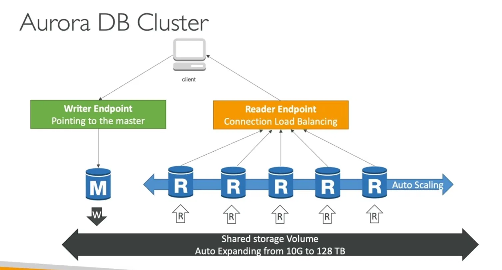

# Aurora DB Cluster



This diagram is actually one of the best Aurora architecture diagrams for the AWS SAA exam.

Let's read it from **bottom → top**, because that's how Aurora really works.

---

# 1. Shared Storage Volume (Bottom Black Bar)

This is the MOST important part.

```
Shared Storage Volume
Auto Expanding from 10 GB to 128 TB
```

Think:

```
                 ONE STORAGE
                      ▲
                      │
    ┌─────────────────┼─────────────────┐
    │                 │                 │
 Writer          Reader1           Reader2
```

All database instances use the SAME storage.

Unlike RDS Read Replicas:

```
Primary → Storage A
Replica → Storage B
Replica → Storage C
```

Aurora:

```
Writer  ─┐
Reader1 ─┼── Shared Storage
Reader2 ─┤
Reader3 ─┘
```

---

# Why is Shared Storage Powerful?

Suppose a user places an order.

```sql
INSERT INTO Orders
```

Writer updates:

```
Shared Storage
```

Immediately all Readers can see the updated data because they are reading from the same storage layer.

AWS doesn't need to copy the whole database to every replica.

This is why:

✅ Lower lag

✅ Faster failover

✅ Better performance

---

# 2. M = Master / Writer Instance

The diagram shows:

```
M
```

M means:

```
Master
or
Writer Instance
```

Only this instance can perform:

```sql
INSERT
UPDATE
DELETE
```

Example:

User buys a phone.

```sql
INSERT INTO Orders
```

Request goes to:

```
Writer Endpoint
      ↓
      M
      ↓
Shared Storage
```

---

# 3. R = Reader Instances

These are:

```
R R R R R
```

Reader instances.

Used only for:

```sql
SELECT
```

queries.

Examples:

```sql
SELECT * FROM Products

SELECT * FROM Reviews

SELECT * FROM Customers
```

These requests go to Readers.

---

# Why Multiple Readers?

Imagine:

### Writes

```
100 orders/minute
```

### Reads

```
50,000 product searches/minute
```

Most traffic is reading.

Aurora spreads those reads among Readers.

---

# 4. Reader Endpoint = Built-In Load Balancer

Notice this:

```
Reader Endpoint
Connection Load Balancing
```

This is extremely important for the exam.

Aurora automatically load balances connections.

---

Without Reader Endpoint:

```
App
 │
 ├── Reader1
 ├── Reader2
 └── Reader3
```

Application must decide where to connect.

Complicated.

---

With Reader Endpoint:

```
App
 │
 ▼
Reader Endpoint
 │
 ├── Reader1
 ├── Reader2
 ├── Reader3
 └── Reader4
```

Aurora decides automatically.

---

Example:

User 1

```sql
SELECT products
```

→ Reader1

User 2

```sql
SELECT reviews
```

→ Reader2

User 3

```sql
SELECT categories
```

→ Reader3

---

# 5. Writer Endpoint

The green box says:

```
Writer Endpoint
Pointing to the master
```

Application doesn't know which server is writer.

It simply connects to:

```
Writer Endpoint
```

Aurora routes to:

```
Current Writer Instance
```

---

Example

```sql
INSERT order
```

↓

Writer Endpoint

↓

Writer

↓

Shared Storage

---

# 6. Auto Scaling Readers

See the blue arrow:

```
Auto Scaling →
```

This means Aurora can automatically create more Readers.

---

Normal Day

```
Writer
Reader1
Reader2
```

Traffic:

```
1000 users
```

Everything fine.

---

Black Friday

```
100,000 users
```

Readers become busy.

CPU reaches threshold.

Aurora Auto Scaling adds:

```
Reader3
Reader4
Reader5
```

Now:

```
Reader Endpoint

 ├─ Reader1
 ├─ Reader2
 ├─ Reader3
 ├─ Reader4
 └─ Reader5
```

Read capacity increases automatically.

---

# 7. What Happens During Failover?

Suppose Writer crashes.

Current state:

```
Writer ❌

Reader1
Reader2
Reader3
```

Aurora promotes a Reader.

Example:

```
Reader2
```

becomes:

```
New Writer
```

Now:

```
Writer = Reader2

Reader1
Reader3
```

---

The best part:

Application still uses:

```
Writer Endpoint
```

No application change needed.

Aurora automatically points Writer Endpoint to the new Writer.

---

# 8. Complete Flow of This Diagram

Imagine an e-commerce site.

---

### User Browses Products

```sql
SELECT * FROM products
```

Flow:

```
Client
  ↓
Reader Endpoint
  ↓
Reader Instance
  ↓
Shared Storage
```

---

### User Places Order

```sql
INSERT INTO orders
```

Flow:

```
Client
  ↓
Writer Endpoint
  ↓
Writer Instance
  ↓
Shared Storage
```

---

### Traffic Spikes

```
CPU > Threshold
```

Aurora creates more Readers.

```
Reader4
Reader5
Reader6
```

---

### Writer Fails

```
Writer ❌
```

Aurora promotes:

```
Reader1
```

to Writer.

Writer Endpoint automatically follows the new Writer.

---

# Exam Memory Trick

When you see this diagram, remember:

```
Client
  │
  ├── Writer Endpoint
  │        │
  │        ▼
  │      Writer
  │
  └── Reader Endpoint
           │
           ▼
    Many Readers
           │
           ▼
    Shared Storage
```

**One Writer**

→ Handles writes

**Many Readers**

→ Handle reads

**Reader Endpoint**

→ Load balances reads

**Writer Endpoint**

→ Always points to current writer

**Shared Storage**

→ One storage layer used by all instances

**Auto Scaling**

→ Adds/removes Readers automatically

**Failover**

→ Reader can be promoted to Writer automatically

This single diagram covers about **80% of the Aurora architecture questions** that appear in the AWS Solutions Architect Associate exam.
