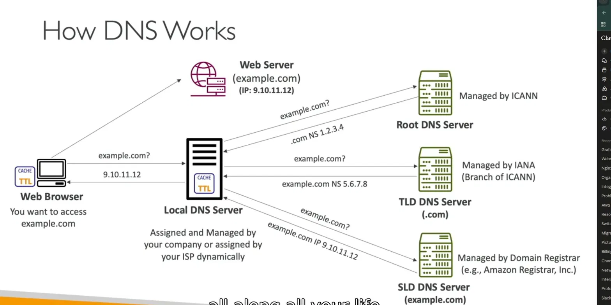

# Domain Name System which translates the human-friendly hostnames

        into the machine IP addresses

        

        ## How DNS Works — Simple Explanation

        Think of DNS like a **phone book for the internet**. You know the name (example.com) but need the phone number (IP address).

        ---

        ### The Flow — Step by Step

        **Step 1 — You type `example.com` in your browser**
