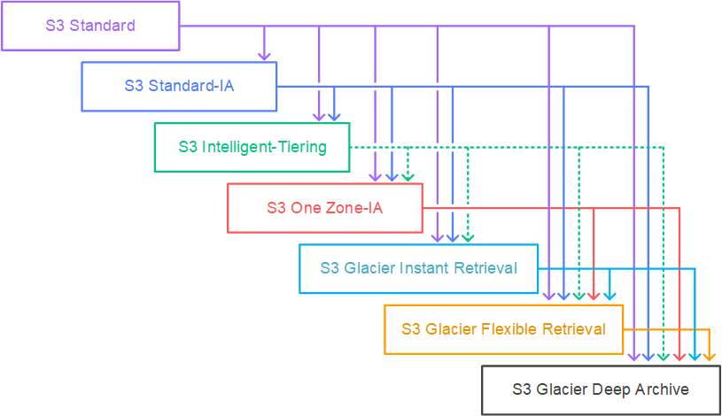

# Part: 1



# Amazon S3 — Moving Between Storage Classes

The core idea is simple:

> **As an object becomes less frequently accessed, move it to a cheaper S3 storage class.**
> 

You can move objects **manually** or automate the process using **S3 Lifecycle Rules**.

---

## 1. Why Move Objects Between Storage Classes?

Different data has different access patterns.

Example:

A company uploads a customer report today.

```
Day 0
Customer report
      ↓
S3 Standard
Frequently accessed
```

After a few months, nobody accesses it anymore:

```
After 30 days
      ↓
S3 Standard-IA
Infrequent access
```

After a year, it becomes an archive:

```
After 365 days
      ↓
S3 Glacier
Long-term archive
```

So you can reduce storage costs without manually managing every object.

---

# 2. Manual Transition

You can manually change an object's storage class.

Example:

```
S3 Standard
     │
     │ Manual transition
     ▼
S3 Standard-IA
     │
     │ Manual transition
     ▼
S3 Glacier
```

Useful when you have a small number of objects or need immediate control.

---

# 3. Automatic Transition — S3 Lifecycle Rules ⭐

For large amounts of data, use:

> **S3 Lifecycle Configuration**
> 

You define rules based on conditions such as:

- Object age
- Prefix
- Object tags
- Current/noncurrent versions

Example:

```
                  S3 Bucket
                      │
                      ▼
              S3 Standard
              Day 0–30
                      │
                After 30 days
                      ▼
             S3 Standard-IA
                      │
                After 90 days
                      ▼
           Glacier Flexible
                      │
               After 365 days
                      ▼
          Glacier Deep Archive
```

S3 automatically performs the transitions.

---

# 4. Real-World Example

Suppose a bank stores transaction reports.

### First 30 days

Reports are frequently accessed by employees.

→ **S3 Standard**

### 30–90 days

Reports are rarely accessed but may be needed quickly.

→ **S3 Standard-IA**

### 90 days+

Reports are mainly kept for compliance.

→ **S3 Glacier**

### Several years later

Reports are almost never accessed but must be retained.

→ **S3 Glacier Deep Archive**

### Lifecycle Rule

```
Object created
      ↓
Standard
      ↓
30 days
      ↓
Standard-IA
      ↓
90 days
      ↓
Glacier
      ↓
365 days
      ↓
Deep Archive
```

This is a classic **cost optimization** architecture.

---

# 5. Important Exam Concept: Transition Based on Access Pattern

Don't simply memorize:

> "After 30 days → Standard-IA"
> 

Instead understand **why**.

```
Frequently accessed
        ↓
S3 Standard

Less frequently accessed
        ↓
S3 Standard-IA

Rarely accessed / archive
        ↓
S3 Glacier

Long-term archive
        ↓
S3 Glacier Deep Archive
```

The **scenario's access pattern and retrieval requirement** determine the class.

---

# 6. Lifecycle Rules Can Also Delete Objects

Lifecycle isn't only for transitions.

You can also automatically delete objects.

Example:

```
Day 0
S3 Standard
    ↓
Day 30
Standard-IA
    ↓
Day 90
Glacier
    ↓
Day 365
Delete
```

Useful for:

- Temporary files
- Logs
- Old backups
- Temporary application data

---

# 7. Lifecycle vs Storage Class

| Concept | Meaning |
| --- | --- |
| **Storage Class** | Determines how an object is stored/cost/accessed |
| **Lifecycle Rule** | Automatically changes storage class or deletes objects |
| **Manual transition** | You explicitly change the object's storage class |
| **Automatic transition** | S3 changes it according to lifecycle rules |

---

# 8. SAA-C03 Scenario

### Question style:

> A company stores millions of objects in S3. Objects are frequently accessed during the first 30 days, rarely accessed after 30 days, and retained for several years for compliance. The company wants to automatically reduce storage costs.
> 

### Think:

```
Frequent
   ↓
Standard

Infrequent
   ↓
Standard-IA

Long-term archive
   ↓
Glacier / Deep Archive
```

**Answer concept:**

> **Configure S3 Lifecycle Rules to transition objects between storage classes based on object age.**
> 

---

## 🧠 Memory Trick

> **Lifecycle = "Object gets older → automatically move it to cheaper storage."**
> 

And remember:

**Standard → IA → Glacier → Deep Archive**

Think:

> **Frequently used → Less used → Archived → Almost never touched**
> 

### 🎯 SAA-C03 Takeaway

> **Use S3 Lifecycle Rules to automatically transition objects to appropriate storage classes as their access frequency decreases, reducing storage costs without manual management.**
>
