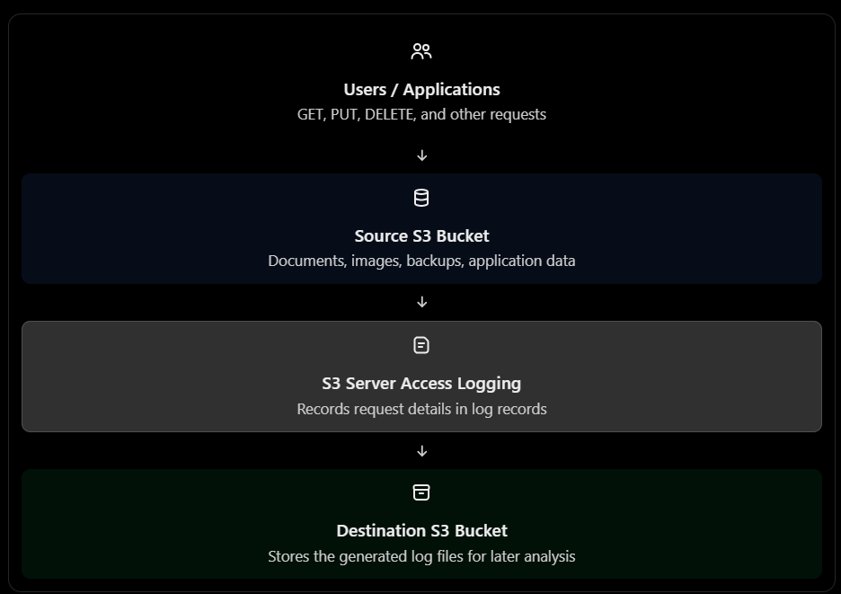

# Amazon S3 Server Access Logging — AWS SAA-C03 Complete Notes

Exam revision • Core concepts • Architecture • Log fields • Examples • Security • Common traps

## 1. What is S3 Server Access Logging?

Amazon S3 Server Access Logging records detailed information about requests made to an S3 bucket.

Think of it as a security and activity logbook for your S3 bucket.

Imagine a company stores confidential documents in an S3 bucket. The security team wants to know:

- Who requested a file?
- Which bucket was accessed?
- When did the request happen?
- What action was performed — GET, PUT, or DELETE?
- Did the request succeed or fail?
- How long did the request take?
- What was the referrer?

S3 Server Access Logging records details about requests so the company can analyze access patterns, investigate issues, and support reporting or auditing.

### Simple architecture



Important: S3 Server Access Logging is a logging feature, not a mechanism for granting or denying access. Permissions are controlled separately through IAM policies, bucket policies, access points, and other applicable controls.

## 2. How does it work?

There are two main buckets to understand.

| Component | Purpose |
| --- | --- |
| Source bucket | The bucket whose requests you want to record |
| Destination bucket | The bucket where the access log files are delivered |

### Example: Electronics company

Suppose an electronics company uses these buckets:

- `company-documents` — stores invoices and product documents.
- `company-access-logs` — stores access log files.

When a user downloads `invoice.pdf`, S3 can generate a log record containing information about the request.

Step 1 — User downloads a document

GET request for `invoice.pdf`

Step 2 — S3 processes the request

The request succeeds or fails.

Step 3 — A log record is generated

The record describes the request and its outcome.

Step 4 — Log files are delivered

S3 delivers them to the configured destination bucket.

### Key characteristics

- Logging is configured on the source bucket.
- Log files are delivered to a destination S3 bucket.
- Delivery is best effort, not guaranteed to be immediate or complete.
- Logs can arrive after a delay, and duplicates can occur.
- Server access logging is not a real-time monitoring or alerting system.
- You can use the delivered log files for reporting and investigation.

Exam memory: Source bucket = what you monitor. Destination bucket = where you store the logs.

## 3. What information does a server access log contain?

Each log record represents an individual request. S3 server access logs can include many fields that help investigate the request.

Amazon Simple Storage Service

+1

| Log field | Simple meaning | Example |
| --- | --- | --- |
| Bucket owner | Account ID of bucket owner | `123456789012` |
| Bucket | Bucket being accessed | `company-documents` |
| Time | When S3 processed the request | `11/Oct/2026:10:15:30` |
| Remote IP | IP address of the requester | `203.0.113.10` |
| Requester | Identity associated with the request, when available | IAM principal or anonymous requester |
| Request ID | Identifier for the request | Useful for troubleshooting |
| Operation | Type of S3 operation | `REST.GET.OBJECT` |
| Object key | Object requested, when applicable | `invoice.pdf` |
| HTTP status | Result of the request | `200`, `403`, `404` |
| Error code | Error information, if any | `AccessDenied` |
| Bytes sent | Response size | `2048` bytes |
| Object size | Size of the requested object, when applicable | `1048576` bytes |
| Total time | Total time taken to process the request | `45` milliseconds |
| Turnaround time | Time spent by S3 processing the request, excluding certain network-related time | `30` milliseconds |
| Referrer | Referring webpage or application, if available | Website URL |
| User agent | Client software making the request | Browser or SDK |
| Authentication type | Authentication method used | Signed request or anonymous |
| TLS details | Transport security information | TLS version and cipher details |

Note: These are illustrative examples, not a single complete raw log record. Some fields may be unavailable or not applicable and appear as a dash (`-`).

### Understand the important fields with a real example

Suppose a finance employee downloads a confidential invoice from S3.

Request time

When the request occurred.

Requester

Helps identify the principal or request source when the information is available.

Operation

`REST.GET.OBJECT` indicates an object retrieval operation.

HTTP status and error

`200` indicates success; `403` commonly indicates an authorization failure.

Turnaround and total time

Help investigate slow requests.

Exam takeaway: If the question lists requester, bucket, request time, operation, referrer, turnaround time, and error code, it is describing the detailed fields of S3 Server Access Logging.

One important qualification: log fields are not guaranteed to be populated for every request.

## 4. What operations can be logged?

Server access logging can record requests to the bucket and its objects, including successful and unsuccessful requests.

| Operation | Example | Why it matters |
| --- | --- | --- |
| `GET` | Download a file | Track reads |
| `PUT` | Upload an object | Track writes |
| `DELETE` | Delete an object | Investigate deletion |
| `HEAD` | Check object metadata | Investigate metadata requests |
| `LIST` | List bucket contents | Understand discovery/access patterns |
| Failed request | Access denied | Investigate permission issues |

### Scenario: Unexpected downloads

A company discovers that a confidential file has been downloaded repeatedly.

The security team wants to investigate:

1. When requests occurred.
2. Which object was requested.
3. What requester information was recorded.
4. Whether requests succeeded or failed.
5. Which IP addresses and client applications were involved, when available.

Server access logs can help reconstruct this activity.

### Exam trap

Server access logging does not mean every request is guaranteed to appear in the logs. Delivery is best effort. For an audit requirement that needs a different event-recording model, consider CloudTrail as well.

## 5. S3 Server Access Logging vs CloudTrail

This is one of the most important SAA-C03 comparisons.

S3 Server Access Logging

Detailed request logs

Best when the question emphasizes request details such as requester, IP, operation, HTTP status, referrer, and request timing.

Example: Investigate which requests accessed an object and how long they took.

AWS CloudTrail

API activity and auditing

Best when the question emphasizes which IAM identity, role, or AWS service performed an API action, with associated event details.

Example: Audit who called `PutBucketPolicy` or performed an S3 object-level API operation.

CloudTrail supports S3 management events and data events. Object-level data events such as `GetObject`, `PutObject`, and `DeleteObject` must be configured for the relevant resources; they are not automatically included in ordinary CloudTrail event history.

Amazon Simple Storage Service

+1

| Requirement in a question | Best fit |
| --- | --- |
| Requester, referrer, turnaround time, HTTP status | Server Access Logging |
| Detailed bucket/object request log records | Server Access Logging |
| Audit API activity by users and roles | CloudTrail |
| Record S3 object-level API events | CloudTrail data events |
| Investigate failed access requests | Server Access Logging and/or CloudTrail, depending on the required detail |
| Automatically react to object creation | S3 Event Notifications |
| Monitor AWS resource configuration changes | CloudTrail and AWS Config, depending on the requirement |

Remember: Server access logs and CloudTrail are complementary, not interchangeable. You can use both when you need detailed request information plus identity-oriented API auditing.

## 6. Server Access Logging vs S3 Event Notifications

These two are easily confused.

| Feature | Server Access Logging | S3 Event Notifications |
| --- | --- | --- |
| Main purpose | Record request activity | Trigger downstream actions |
| Typical output | Log records delivered to a destination | Event delivered to a configured destination |
| Typical use | Audit and investigate requests | Process new files automatically |
| Example | Record a `GET` request | Upload image → trigger Lambda |
| Request timing details | Available in log fields | Not a replacement for access-log fields |
| Destination examples | S3 bucket or CloudWatch Logs | Lambda, SQS, SNS, EventBridge |

### Scenario A — Reporting

“Record request time, requester, object key, HTTP status, and turnaround time.”

→ Server Access Logging

### Scenario B — Automation

“Whenever a customer uploads an image, generate a thumbnail.”

→ S3 Event Notification → Lambda

Memory shortcut:

> Logging records what happened. Notifications trigger what happens next.
> 

## 7. How do you enable Server Access Logging?

The basic setup is straightforward.

## 1

Choose the source bucketOpen the S3 console and select the bucket you want to monitor.

## 2

Open PropertiesFind the Server access logging section and enable logging.

## 3

Choose the destination bucketSelect a suitable bucket in the same AWS account and Region.

## 4

Set a log prefixFor example, `access-logs/company-documents/`.

## 5

Configure destination permissionsEnsure the S3 logging service principal can write log objects.

The console can configure the destination bucket policy automatically. If you configure logging through the API or CLI, you may need to configure permissions yourself.

Amazon Simple Storage Service

+1

### Example bucket layout

```
company-documents/                 ← Source bucket
          │
          │ Server Access Logging
          ▼
company-access-logs/               ← Destination bucket
          │
          └── access-logs/
                  └── company-documents/
                          └── generated log files
```

The prefix helps you identify which source bucket the logs belong to.

## 7.5 Server Access Logging vs. CloudTrail vs. Event Notifications

This comparison is essential for SAA-C03 because these services can sound similar in exam questions.

#### **S3 Server Access Logging**

Best when you need detailed request records, such as HTTP status, operation, referrer, bytes sent, total time, and turnaround time.

Think: detailed S3 request log.

#### AWS CloudTrail

Best when you need to audit API activity and identify which user, role, or AWS service performed an action. Enable S3 data events when you need object-level API activity such as `GetObject`, `PutObject`, and `DeleteObject`.

Think: who performed which AWS API action?

#### S3 Event Notifications

Best when an S3 event should trigger an action, such as sending an event to Lambda, SQS, or SNS after an object is created or deleted.

Think: react to an event.

Requester Pays

Best when the bucket owner wants the requester to pay applicable request and data-transfer charges. It is not a logging or auditing solution.

Think: who pays the bill?

### Quick comparison table

| Requirement in the question | Best match |
| --- | --- |
| HTTP referrer, turnaround time, detailed request records | S3 Server Access Logging |
| Audit which IAM identity performed an S3 API action | CloudTrail |
| Track `GetObject`, `PutObject`, and `DeleteObject` as auditable API events | CloudTrail S3 data events |
| Run Lambda after an object is uploaded | S3 Event Notifications |
| Send events to SQS/SNS after supported S3 events | S3 Event Notifications |
| Make the requester pay for requests and data transfer | Requester Pays |

Important nuance: Both Server Access Logging and CloudTrail can provide visibility into object operations. Do not choose solely because a question mentions “object-level operations.” Look for the other clues:

- Detailed request fields such as `HTTP Referer`, `Total Time`, and `Turn-Around Time` → Server Access Logging.
- Audit identity, API event history, and security/compliance tracking → CloudTrail.
- Trigger an automated workflow → Event Notifications.

Official reference: [Logging options for Amazon S3](https://docs.aws.amazon.com/AmazonS3/latest/userguide/logging-with-S3.html).

Amazon Simple Storage Service

+1

## 8. Destination bucket requirements and common pitfalls

This is a high-value area for scenario questions.

| Requirement | Important rule |
| --- | --- |
| Destination Region | Must be the same Region as the source bucket for delivery directly to an S3 bucket |
| Destination account | Must be the same AWS account as the source bucket for direct S3-bucket delivery |
| Destination permissions | Must permit the logging service to write log objects |
| Destination Object Ownership | With Bucket owner enforced, use a bucket policy instead of ACLs |
| Destination encryption | Use SSE-S3 for reliable direct S3 destination delivery; SSE-KMS default encryption can cause access/decryption complications |
| Destination Object Lock | A bucket with Object Lock enabled cannot be the destination |
| Requester Pays | The destination bucket must not have Requester Pays enabled |
| Destination logging | Avoid enabling access logging on the destination bucket |
| Delivery timing | Logs may take hours to arrive |
| Delivery completeness | Best effort, not guaranteed |
| Cost | No additional charge for enabling S3 server access logging; delivered logs incur normal storage charges |

These restrictions apply to the direct-to-S3 destination option. AWS also supports delivery to CloudWatch Logs, which has different capabilities, including structured logs and cross-account or cross-Region aggregation.

Amazon Simple Storage Service

+2

### Why shouldn't you log a bucket into itself?

Imagine that the source bucket is also the destination:

```
Request to bucket
       ↓
Access log written to same bucket
       ↓
That write generates another log
       ↓
Another log write...
```

This can create a feedback loop and excessive log generation. Use a separate destination bucket.

### Why is SSE-KMS worth remembering?

If the destination bucket's default encryption uses SSE-KMS, log objects may be delivered in a way that leaves you unable to access them with your intended KMS permissions. For direct S3 destination logging, SSE-S3 is the safer exam answer.

Amazon Simple Storage Service

+1

## 9. How can you analyze the generated logs?

The log files are useful only if you can query or inspect them.

| Tool | Purpose |
| --- | --- |
| Amazon S3 | Store the log files durably |
| Amazon Athena | Run SQL queries against logs stored in S3 |
| CloudWatch Logs Insights | Query structured logs delivered to CloudWatch Logs |
| CloudWatch dashboards/alarms | Monitor and alert when you have appropriate metrics or log-based monitoring configured |

### Example: Find failed requests

Suppose the company wants to find requests that returned `403 AccessDenied`.

The workflow can be:

```
S3 Server Access Logging
          ↓
Destination S3 Bucket
          ↓
Amazon Athena
          ↓
Query log records
          ↓
Identify failed requests
```

For example, a team could query the logs for a time range, bucket, operation, or status code.

Exam trigger: “Store S3 access logs and query them with SQL” → Server Access Logging + Amazon Athena.

If the question instead emphasizes interactive log querying, cross-account aggregation, or structured log processing, consider CloudWatch Logs delivery and CloudWatch Logs Insights.

Amazon Simple Storage Service

+1

## 10. Scenario practice — recognize the correct feature

## Mini exam: 5 questions

0/5 answered

1. A company needs records containing the requester, request time, operation, referrer, turnaround time, and HTTP error code.

A. S3 Server Access Logging

B. S3 Event Notifications

C. Requester Pays

D. S3 Lifecycle

2. An application must process every new image upload by invoking Lambda.

A. Server Access Logging

B. S3 Event Notifications

C. S3 Inventory

D. CloudTrail management events

3. A security team must audit which IAM role called PutBucketPolicy.

A. S3 Lifecycle

B. CloudTrail

C. S3 Transfer Acceleration

D. S3 Inventory

4. Access logs are enabled, but no log files arrive immediately.

A. Assume the feature is broken

B. Wait and check destination permissions/configuration

C. Enable Requester Pays

D. Enable Versioning only

5. The destination bucket has Object Lock enabled.

A. Use it as-is

B. Disable source versioning

C. Choose a different eligible destination bucket

D. Enable Transfer Acceleration

Reset practice

## 11. Final SAA-C03 confusion-buster table

| Question wording | Correct feature | Why |
| --- | --- | --- |
| Track requester, request time, operation, referrer, and turnaround time | S3 Server Access Logging | Detailed request records |
| Audit who performed AWS API actions | CloudTrail | Identity and API event auditing |
| Track object-level API events through CloudTrail | CloudTrail data events | Object API activity |
| Trigger processing after object upload | S3 Event Notifications | Event-driven automation |
| Query access log records with SQL | Athena | SQL analytics on S3 data |
| Query structured logs interactively | CloudWatch Logs Insights | Log analysis |
| Logs do not appear immediately | Check delivery delay and configuration | Best-effort delivery |
| Logging delivery fails | Check destination permissions and restrictions | The logging service needs write access |
| Destination uses Object Lock | Select another destination | Unsupported destination |
| Logs must be kept for analysis | Dedicated destination S3 bucket | Separates data from logs |
| Need centralized cross-Region log aggregation | Consider CloudWatch Logs delivery | Supports broader aggregation options |

## 12. Five-minute exam memory sheet

### Remember these six rules

Detailed request fields → Server Access Logging

Requester, bucket, operation, referrer, turnaround time, HTTP status.

Identity and API audit → CloudTrail

Enable data events for S3 object-level API activity when required.

React to uploads → Event Notifications

For example, invoke Lambda when an image is created.

Log delivery → Best effort

Not guaranteed to be complete or immediate.

Destination bucket → Same account and Region

For direct delivery to an S3 general purpose bucket.

Troubleshoot delivery → Permissions and destination restrictions

Check the logging service principal, encryption, Object Lock, and Requester Pays settings.

One-line memory trick:

> Server Access Logging = detailed S3 request history; CloudTrail = AWS API audit trail; Event Notifications = automatic reactions to S3 events.
> 

### Official AWS references

- [S3 Server Access Logging — concepts and delivery](https://docs.aws.amazon.com/AmazonS3/latest/userguide/ServerLogs.html)
- [S3 server access log fields and format](https://docs.aws.amazon.com/AmazonS3/latest/userguide/LogFormat.html)
- [Enable logging and configure destination permissions](https://docs.aws.amazon.com/AmazonS3/latest/userguide/enable-server-access-logging.html)
- [Compare S3 logging options](https://docs.aws.amazon.com/AmazonS3/latest/userguide/logging-with-S3.html)

# Amazon S3 Server Access Logging — AWS SAA-C03 Complete Notes

## 1. What is S3 Server Access Logging?

Amazon S3 Server Access Logging records detailed information about requests made to an S3 bucket.

Think of it as a security and activity logbook for your S3 bucket.

Imagine a company stores confidential documents in an S3 bucket. The security team wants to know:

- Who requested a file?
- Which bucket was accessed?
- When did the request happen?
- What action was performed — GET, PUT, or DELETE?
- Did the request succeed or fail?
- How long did the request take?
- What was the referrer?

S3 Server Access Logging records details about requests so the company can analyze access patterns, investigate issues, and support reporting or auditing.

### Simple architecture


Important: S3 Server Access Logging is a logging feature, not a mechanism for granting or denying access. Permissions are controlled separately through IAM policies, bucket policies, access points, and other applicable controls.

## 2. How does it work?

There are two main buckets to understand.

| Component | Purpose |
| --- | --- |
| Source bucket | The bucket whose requests you want to record |
| Destination bucket | The bucket where the access log files are delivered |

### Example: Electronics company

Suppose an electronics company uses these buckets:

- `company-documents` — stores invoices and product documents.
- `company-access-logs` — stores access log files.

When a user downloads `invoice.pdf`, S3 can generate a log record containing information about the request.

Step 1 — User downloads a document

GET request for `invoice.pdf`

Step 2 — S3 processes the request

The request succeeds or fails.

Step 3 — A log record is generated

The record describes the request and its outcome.

Step 4 — Log files are delivered

S3 delivers them to the configured destination bucket.

### Key characteristics

- Logging is configured on the source bucket.
- Log files are delivered to a destination S3 bucket.
- Delivery is best effort, not guaranteed to be immediate or complete.
- Logs can arrive after a delay, and duplicates can occur.
- Server access logging is not a real-time monitoring or alerting system.
- You can use the delivered log files for reporting and investigation.

Exam memory: Source bucket = what you monitor. Destination bucket = where you store the logs.

## 3. What information does a server access log contain?

Each log record represents an individual request. S3 server access logs can include many fields that help investigate the request.

Amazon Simple Storage Service

+1

| Log field | Simple meaning | Example |
| --- | --- | --- |
| Bucket owner | Account ID of bucket owner | `123456789012` |
| Bucket | Bucket being accessed | `company-documents` |
| Time | When S3 processed the request | `11/Oct/2026:10:15:30` |
| Remote IP | IP address of the requester | `203.0.113.10` |
| Requester | Identity associated with the request, when available | IAM principal or anonymous requester |
| Request ID | Identifier for the request | Useful for troubleshooting |
| Operation | Type of S3 operation | `REST.GET.OBJECT` |
| Object key | Object requested, when applicable | `invoice.pdf` |
| HTTP status | Result of the request | `200`, `403`, `404` |
| Error code | Error information, if any | `AccessDenied` |
| Bytes sent | Response size | `2048` bytes |
| Object size | Size of the requested object, when applicable | `1048576` bytes |
| Total time | Total time taken to process the request | `45` milliseconds |
| Turnaround time | Time spent by S3 processing the request, excluding certain network-related time | `30` milliseconds |
| Referrer | Referring webpage or application, if available | Website URL |
| User agent | Client software making the request | Browser or SDK |
| Authentication type | Authentication method used | Signed request or anonymous |
| TLS details | Transport security information | TLS version and cipher details |

Note: These are illustrative examples, not a single complete raw log record. Some fields may be unavailable or not applicable and appear as a dash (`-`).

### Understand the important fields with a real example

Suppose a finance employee downloads a confidential invoice from S3.

Request time

When the request occurred.

Requester

Helps identify the principal or request source when the information is available.

Operation

`REST.GET.OBJECT` indicates an object retrieval operation.

HTTP status and error

`200` indicates success; `403` commonly indicates an authorization failure.

Turnaround and total time

Help investigate slow requests.

Exam takeaway: If the question lists requester, bucket, request time, operation, referrer, turnaround time, and error code, it is describing the detailed fields of S3 Server Access Logging.

One important qualification: log fields are not guaranteed to be populated for every request.

## 4. What operations can be logged?

Server access logging can record requests to the bucket and its objects, including successful and unsuccessful requests.

| Operation | Example | Why it matters |
| --- | --- | --- |
| `GET` | Download a file | Track reads |
| `PUT` | Upload an object | Track writes |
| `DELETE` | Delete an object | Investigate deletion |
| `HEAD` | Check object metadata | Investigate metadata requests |
| `LIST` | List bucket contents | Understand discovery/access patterns |
| Failed request | Access denied | Investigate permission issues |

### Scenario: Unexpected downloads

A company discovers that a confidential file has been downloaded repeatedly.

The security team wants to investigate:

1. When requests occurred.
2. Which object was requested.
3. What requester information was recorded.
4. Whether requests succeeded or failed.
5. Which IP addresses and client applications were involved, when available.

Server access logs can help reconstruct this activity.

### Exam trap

Server access logging does not mean every request is guaranteed to appear in the logs. Delivery is best effort. For an audit requirement that needs a different event-recording model, consider CloudTrail as well.

## 5. S3 Server Access Logging vs CloudTrail

This is one of the most important SAA-C03 comparisons.

S3 Server Access Logging

Detailed request logs

Best when the question emphasizes request details such as requester, IP, operation, HTTP status, referrer, and request timing.

Example: Investigate which requests accessed an object and how long they took.

AWS CloudTrail

API activity and auditing

Best when the question emphasizes which IAM identity, role, or AWS service performed an API action, with associated event details.

Example: Audit who called `PutBucketPolicy` or performed an S3 object-level API operation.

CloudTrail supports S3 management events and data events. Object-level data events such as `GetObject`, `PutObject`, and `DeleteObject` must be configured for the relevant resources; they are not automatically included in ordinary CloudTrail event history.

Amazon Simple Storage Service

+1

| Requirement in a question | Best fit |
| --- | --- |
| Requester, referrer, turnaround time, HTTP status | Server Access Logging |
| Detailed bucket/object request log records | Server Access Logging |
| Audit API activity by users and roles | CloudTrail |
| Record S3 object-level API events | CloudTrail data events |
| Investigate failed access requests | Server Access Logging and/or CloudTrail, depending on the required detail |
| Automatically react to object creation | S3 Event Notifications |
| Monitor AWS resource configuration changes | CloudTrail and AWS Config, depending on the requirement |

Remember: Server access logs and CloudTrail are complementary, not interchangeable. You can use both when you need detailed request information plus identity-oriented API auditing.

## 6. Server Access Logging vs S3 Event Notifications

These two are easily confused.

| Feature | Server Access Logging | S3 Event Notifications |
| --- | --- | --- |
| Main purpose | Record request activity | Trigger downstream actions |
| Typical output | Log records delivered to a destination | Event delivered to a configured destination |
| Typical use | Audit and investigate requests | Process new files automatically |
| Example | Record a `GET` request | Upload image → trigger Lambda |
| Request timing details | Available in log fields | Not a replacement for access-log fields |
| Destination examples | S3 bucket or CloudWatch Logs | Lambda, SQS, SNS, EventBridge |

### Scenario A — Reporting

“Record request time, requester, object key, HTTP status, and turnaround time.”

→ Server Access Logging

### Scenario B — Automation

“Whenever a customer uploads an image, generate a thumbnail.”

→ S3 Event Notification → Lambda

Memory shortcut:

> Logging records what happened. Notifications trigger what happens next.
> 

## 7. How do you enable Server Access Logging?

The basic setup is straightforward.

## 1

Choose the source bucketOpen the S3 console and select the bucket you want to monitor.

## 2

Open PropertiesFind the Server access logging section and enable logging.

## 3

Choose the destination bucketSelect a suitable bucket in the same AWS account and Region.

## 4

Set a log prefixFor example, `access-logs/company-documents/`.

## 5

Configure destination permissionsEnsure the S3 logging service principal can write log objects.

The console can configure the destination bucket policy automatically. If you configure logging through the API or CLI, you may need to configure permissions yourself.

Amazon Simple Storage Service

+1

### Example bucket layout

```
company-documents/                 ← Source bucket
          │
          │ Server Access Logging
          ▼
company-access-logs/               ← Destination bucket
          │
          └── access-logs/
                  └── company-documents/
                          └── generated log files
```

The prefix helps you identify which source bucket the logs belong to.

## 7.5 Server Access Logging vs. CloudTrail vs. Event Notifications

This comparison is essential for SAA-C03 because these services can sound similar in exam questions.

#### **S3 Server Access Logging**

Best when you need detailed request records, such as HTTP status, operation, referrer, bytes sent, total time, and turnaround time.

Think: detailed S3 request log.

#### AWS CloudTrail

Best when you need to audit API activity and identify which user, role, or AWS service performed an action. Enable S3 data events when you need object-level API activity such as `GetObject`, `PutObject`, and `DeleteObject`.

Think: who performed which AWS API action?

S3 Event Notifications

Best when an S3 event should trigger an action, such as sending an event to Lambda, SQS, or SNS after an object is created or deleted.

Think: react to an event.

Requester Pays

Best when the bucket owner wants the requester to pay applicable request and data-transfer charges. It is not a logging or auditing solution.

Think: who pays the bill?

### Quick comparison table

| Requirement in the question | Best match |
| --- | --- |
| HTTP referrer, turnaround time, detailed request records | S3 Server Access Logging |
| Audit which IAM identity performed an S3 API action | CloudTrail |
| Track `GetObject`, `PutObject`, and `DeleteObject` as auditable API events | CloudTrail S3 data events |
| Run Lambda after an object is uploaded | S3 Event Notifications |
| Send events to SQS/SNS after supported S3 events | S3 Event Notifications |
| Make the requester pay for requests and data transfer | Requester Pays |

Important nuance: Both Server Access Logging and CloudTrail can provide visibility into object operations. Do not choose solely because a question mentions “object-level operations.” Look for the other clues:

- Detailed request fields such as `HTTP Referer`, `Total Time`, and `Turn-Around Time` → Server Access Logging.
- Audit identity, API event history, and security/compliance tracking → CloudTrail.
- Trigger an automated workflow → Event Notifications.

Official reference: [Logging options for Amazon S3](https://docs.aws.amazon.com/AmazonS3/latest/userguide/logging-with-S3.html).

Amazon Simple Storage Service

+1

## 8. Destination bucket requirements and common pitfalls

This is a high-value area for scenario questions.

| Requirement | Important rule |
| --- | --- |
| Destination Region | Must be the same Region as the source bucket for delivery directly to an S3 bucket |
| Destination account | Must be the same AWS account as the source bucket for direct S3-bucket delivery |
| Destination permissions | Must permit the logging service to write log objects |
| Destination Object Ownership | With Bucket owner enforced, use a bucket policy instead of ACLs |
| Destination encryption | Use SSE-S3 for reliable direct S3 destination delivery; SSE-KMS default encryption can cause access/decryption complications |
| Destination Object Lock | A bucket with Object Lock enabled cannot be the destination |
| Requester Pays | The destination bucket must not have Requester Pays enabled |
| Destination logging | Avoid enabling access logging on the destination bucket |
| Delivery timing | Logs may take hours to arrive |
| Delivery completeness | Best effort, not guaranteed |
| Cost | No additional charge for enabling S3 server access logging; delivered logs incur normal storage charges |

These restrictions apply to the direct-to-S3 destination option. AWS also supports delivery to CloudWatch Logs, which has different capabilities, including structured logs and cross-account or cross-Region aggregation.

Amazon Simple Storage Service

+2

### Why shouldn't you log a bucket into itself?

Imagine that the source bucket is also the destination:

```
Request to bucket
       ↓
Access log written to same bucket
       ↓
That write generates another log
       ↓
Another log write...
```

This can create a feedback loop and excessive log generation. Use a separate destination bucket.

### Why is SSE-KMS worth remembering?

If the destination bucket's default encryption uses SSE-KMS, log objects may be delivered in a way that leaves you unable to access them with your intended KMS permissions. For direct S3 destination logging, SSE-S3 is the safer exam answer.

Amazon Simple Storage Service

+1

## 9. How can you analyze the generated logs?

The log files are useful only if you can query or inspect them.

| Tool | Purpose |
| --- | --- |
| Amazon S3 | Store the log files durably |
| Amazon Athena | Run SQL queries against logs stored in S3 |
| CloudWatch Logs Insights | Query structured logs delivered to CloudWatch Logs |
| CloudWatch dashboards/alarms | Monitor and alert when you have appropriate metrics or log-based monitoring configured |

### Example: Find failed requests

Suppose the company wants to find requests that returned `403 AccessDenied`.

The workflow can be:

```
S3 Server Access Logging
          ↓
Destination S3 Bucket
          ↓
Amazon Athena
          ↓
Query log records
          ↓
Identify failed requests
```

For example, a team could query the logs for a time range, bucket, operation, or status code.

Exam trigger: “Store S3 access logs and query them with SQL” → Server Access Logging + Amazon Athena.

If the question instead emphasizes interactive log querying, cross-account aggregation, or structured log processing, consider CloudWatch Logs delivery and CloudWatch Logs Insights.

Amazon Simple Storage Service

+1

## 10. Scenario practice — recognize the correct feature

## Mini exam: 5 questions

0/5 answered

1. A company needs records containing the requester, request time, operation, referrer, turnaround time, and HTTP error code.

A. S3 Server Access Logging

B. S3 Event Notifications

C. Requester Pays

D. S3 Lifecycle

2. An application must process every new image upload by invoking Lambda.

A. Server Access Logging

B. S3 Event Notifications

C. S3 Inventory

D. CloudTrail management events

3. A security team must audit which IAM role called PutBucketPolicy.

A. S3 Lifecycle

B. CloudTrail

C. S3 Transfer Acceleration

D. S3 Inventory

4. Access logs are enabled, but no log files arrive immediately.

A. Assume the feature is broken

B. Wait and check destination permissions/configuration

C. Enable Requester Pays

D. Enable Versioning only

5. The destination bucket has Object Lock enabled.

A. Use it as-is

B. Disable source versioning

C. Choose a different eligible destination bucket

D. Enable Transfer Acceleration

Reset practice

## 11. Final SAA-C03 confusion-buster table

| Question wording | Correct feature | Why |
| --- | --- | --- |
| Track requester, request time, operation, referrer, and turnaround time | S3 Server Access Logging | Detailed request records |
| Audit who performed AWS API actions | CloudTrail | Identity and API event auditing |
| Track object-level API events through CloudTrail | CloudTrail data events | Object API activity |
| Trigger processing after object upload | S3 Event Notifications | Event-driven automation |
| Query access log records with SQL | Athena | SQL analytics on S3 data |
| Query structured logs interactively | CloudWatch Logs Insights | Log analysis |
| Logs do not appear immediately | Check delivery delay and configuration | Best-effort delivery |
| Logging delivery fails | Check destination permissions and restrictions | The logging service needs write access |
| Destination uses Object Lock | Select another destination | Unsupported destination |
| Logs must be kept for analysis | Dedicated destination S3 bucket | Separates data from logs |
| Need centralized cross-Region log aggregation | Consider CloudWatch Logs delivery | Supports broader aggregation options |

## 12. Five-minute exam memory sheet

### Remember these six rules

Detailed request fields → Server Access Logging

Requester, bucket, operation, referrer, turnaround time, HTTP status.

Identity and API audit → CloudTrail

Enable data events for S3 object-level API activity when required.

React to uploads → Event Notifications

For example, invoke Lambda when an image is created.

Log delivery → Best effort

Not guaranteed to be complete or immediate.

Destination bucket → Same account and Region

For direct delivery to an S3 general purpose bucket.

Troubleshoot delivery → Permissions and destination restrictions

Check the logging service principal, encryption, Object Lock, and Requester Pays settings.

One-line memory trick:

> Server Access Logging = detailed S3 request history; CloudTrail = AWS API audit trail; Event Notifications = automatic reactions to S3 events.
> 

### Official AWS references

- [S3 Server Access Logging — concepts and delivery](https://docs.aws.amazon.com/AmazonS3/latest/userguide/ServerLogs.html)
- [S3 server access log fields and format](https://docs.aws.amazon.com/AmazonS3/latest/userguide/LogFormat.html)
- [Enable logging and configure destination permissions](https://docs.aws.amazon.com/AmazonS3/latest/userguide/enable-server-access-logging.html)
- [Compare S3 logging options](https://docs.aws.amazon.com/AmazonS3/latest/userguide/logging-with-S3.html)
