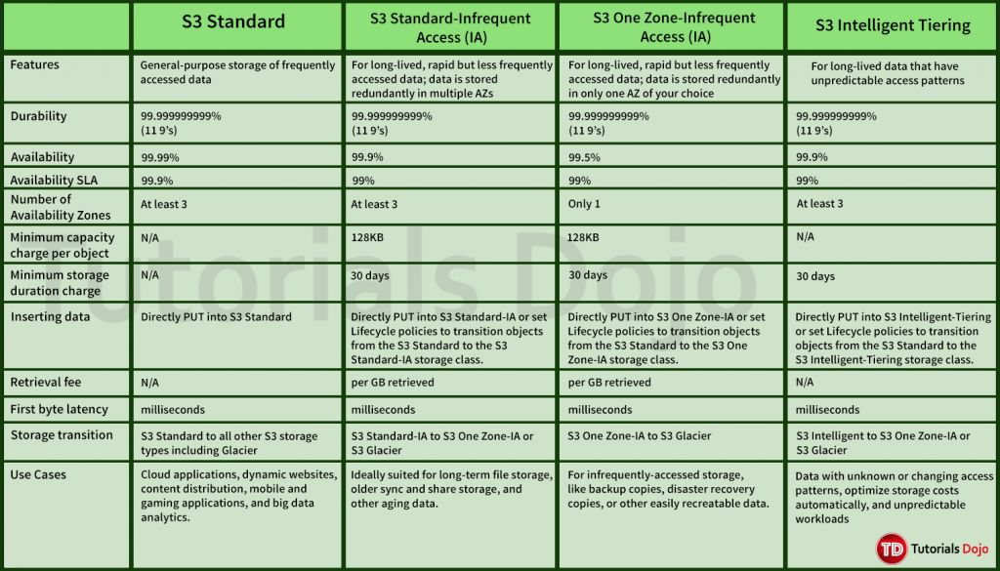

# Master Revise table

Absolutely. Here is a **single-table S3 master revision sheet** designed for **AWS SAA-C03 exam-night revision**. The goal is that you can scan the table and immediately recognise **what it is, what problem it solves, how it works, and when AWS would expect you to choose it**.

### Amazon S3 — Master SAA-C03 Revision Table

| S3 Topic | What it is / Does | Problem it solves | Key points to remember | Typical SAA-C03 scenario / clue |
| --- | --- | --- | --- | --- |
| **S3 Overview** | Object storage service using **buckets + objects** | Need highly durable, scalable storage for files/data | Bucket name globally unique; bucket is regional; object = key + data + metadata + tags; virtually unlimited scale | Store backups, images, logs, datasets, static assets |
| **S3 Bucket** | Container for S3 objects | Organize and control objects | Bucket exists in one AWS Region; name globally unique | Create `company-backup-prod` bucket |
| **S3 Object** | Individual file/data stored in bucket | Store actual data | Object identified by **key**; key looks like a path but S3 has no real directories | `s3://bucket/images/2026/photo.jpg` |
| **S3 Bucket Policy** | JSON resource-based policy attached to bucket | Control who can access bucket/objects | `Effect`, `Principal`, `Action`, `Resource`, `Condition`; supports cross-account access | Allow another AWS account to read objects |
| **Block Public Access** | Safety controls preventing public S3 access | Prevent accidental data exposure | Can apply at bucket/account level; generally keep enabled unless public access is intentionally required | Company wants to ensure private data can never become public |
| **S3 Static Website Hosting** | Hosts static HTML/CSS/JS directly from S3 | Host a simple static website without servers | No server-side code; public access usually required; HTTPS is better handled through **CloudFront** | Host a static company website |
| **S3 Versioning** | Keeps multiple versions of same object | Protect against accidental overwrite/deletion | Enabled at bucket level; version IDs; deleted object can be restored; suspending versioning doesn't delete old versions | Developer accidentally overwrites `config.json`; restore previous version |
| **S3 MFA Delete** | Requires MFA for sensitive versioning operations | Protect against malicious/accidental permanent deletion | Versioning must be enabled; protects permanent version deletion and versioning suspension | Critical bucket must require MFA before permanent object-version deletion |
| **S3 Replication — CRR** | Asynchronously copies objects to another Region | DR, compliance, geographic access | Versioning required on source & destination; cross-account possible | Replicate production data from `us-east-1` to `eu-west-1` |
| **S3 Replication — SRR** | Replicates objects within same Region | Same-region copies, aggregation, environments | Versioning required; asynchronous | Replicate logs from multiple buckets into a centralized bucket |
| **S3 Batch Replication** | Replicates existing objects / failed replications | Normal replication primarily handles newly eligible objects | Useful after enabling replication or for failed objects | Existing 10 TB dataset needs replication after replication configuration |
| **S3 Lifecycle Rules** | Automatically transitions/deletes objects based on age | Reduce storage cost and automate retention | Can transition storage classes and expire objects; rules can use prefixes/tags | Logs: Standard → IA → Glacier → delete |
| **S3 Storage Classes** | Different cost/access models for objects | Optimize storage cost based on access pattern | Standard, IA, One Zone-IA, Glacier classes, Intelligent-Tiering, Express One Zone | Frequently accessed → Standard; archive → Glacier |
| **S3 Standard** | General-purpose object storage | Frequently accessed data | High availability/performance; multi-AZ design | Website assets, active application data |
| **S3 Standard-IA** | Lower-cost storage for infrequently accessed data | Store data rarely accessed but requiring fast retrieval | Multi-AZ; retrieval charges; minimum storage duration | Backups accessed occasionally |
| **S3 One Zone-IA** | IA storage in a single AZ | Cheaper storage for re-creatable data | Single AZ; lower availability; data can be lost if AZ is destroyed | Secondary backup that can be recreated |
| **S3 Glacier Instant Retrieval** | Archive storage with millisecond retrieval | Long-term data rarely accessed but requiring immediate access | Archive class; retrieval charge; minimum storage duration | Medical archive accessed once every few months but immediately |
| **S3 Glacier Flexible Retrieval** | Low-cost archive with retrieval ranging from minutes to hours | Long-term backup/archive where immediate access isn't always required | Expedited / Standard / Bulk retrieval options | Backup archive that may need retrieval within hours |
| **S3 Glacier Deep Archive** | Lowest-cost long-term S3 archival | Very long-term retention | Retrieval takes hours; designed for rarely accessed data | 7–10 year compliance archive |
| **S3 Intelligent-Tiering** | Automatically moves objects between access tiers | Don't know future access pattern | Automatic tiering; monitoring/automation fee; designed to avoid manual optimization | Data access patterns are unpredictable |
| **S3 Express One Zone** | High-performance single-AZ S3 storage | Very latency-sensitive, high-request workloads | Single AZ; directory buckets; very high request performance | ML, analytics, HPC, data-intensive applications requiring very low latency |
| **S3 Durability** | Measures likelihood of losing an object | Data protection | S3 is designed for extremely high durability; commonly represented as **11 nines** | Need highly durable object storage |
| **S3 Availability** | Measures how often service/data is available | Understand service availability | **Different storage classes have different availability** | Don't confuse durability with availability |
| **S3 Encryption** | Encrypts objects at rest | Protect stored data | SSE-S3, SSE-KMS, DSSE-KMS, SSE-C; client-side encryption also possible | Compliance requires encryption at rest |
| **SSE-S3** | AWS-managed S3 server-side encryption | Simple encryption at rest | AWS manages encryption keys; default encryption for new S3 objects | "Encrypt all S3 objects with minimal management" |
| **SSE-KMS** | Server-side encryption using AWS KMS keys | Need more control/audit over encryption keys | KMS permissions + API calls; supports key policies; CloudTrail integration | Compliance requires customer-controlled KMS key and audit trail |
| **DSSE-KMS** | Dual-layer server-side encryption using KMS | Stronger encryption requirements | Two layers of server-side encryption | Requirement specifically asks for dual-layer encryption |
| **SSE-C** | Customer provides encryption key with request | Customer wants to manage encryption key material | AWS performs encryption/decryption but customer supplies key | Application must provide its own encryption key with every request |
| **Client-Side Encryption** | Data encrypted before uploading to S3 | Customer wants encryption before AWS receives data | Application/customer manages encryption | Sensitive data must be encrypted before leaving application |
| **Default Encryption** | Automatically encrypts new objects | Ensure objects are encrypted without requiring application changes | S3 automatically encrypts new objects by default | "All newly uploaded S3 objects must be encrypted" |
| **Force Encryption** | Bucket policy denies uploads that don't satisfy encryption requirement | Ensure clients cannot bypass required encryption | Bucket policy can explicitly deny unencrypted uploads | "Reject any PUT request unless SSE-KMS is used" |
| **Encryption in Transit** | Protects data while traveling over network | Prevent interception | Use HTTPS/TLS; bucket policy can use `aws:SecureTransport` | "S3 requests must use HTTPS" |
| **S3 CORS** | Allows browser-based requests from another origin | Browser blocks cross-origin requests by default | Configure allowed origins/methods/headers | Website hosted on `example.com` directly accesses S3 from browser |
| **S3 Access Logs** | Records requests made against S3 bucket | Audit/access analysis | Logs can be delivered to another S3 bucket | Security team wants records of requests to a sensitive bucket |
| **S3 Server Access Logging** | Detailed request-level logging for S3 | Investigate who accessed what and when | Destination bucket should generally be different from source | Audit access to production bucket |
| **S3 Pre-Signed URL** | Temporary URL granting access to a specific object | Give temporary access without making bucket public | Uses creator's permissions; expiration; GET/PUT can be supported | Allow a user to download a private file for 15 minutes |
| **S3 Requester Pays** | Requester pays request/data-transfer costs | Shift S3 access costs to users accessing data | Requester must explicitly acknowledge payment | Public research dataset where users should pay their own retrieval/request charges |
| **S3 Event Notifications** | Sends events when S3 actions occur | Automatically trigger processing after object changes | Events include ObjectCreated, ObjectRemoved, etc.; destinations include Lambda, SQS, SNS | Image uploaded → Lambda generates thumbnail |
| **S3 + EventBridge** | Sends S3 events to EventBridge | Need advanced event routing/filtering | Advanced JSON filtering; many AWS service destinations; archive/replay | Trigger Step Functions only when a large `.csv` object is uploaded |
| **S3 Performance** | S3 is designed for high request throughput | Need scalable object access | Prefix-based organization can help workload distribution; S3 scales automatically | Application has very high-volume object requests |
| **S3 Multipart Upload** | Uploads large object in multiple parts | Large/unstable uploads | Parts upload independently; failed part can be retried; parts are combined at completion | Upload a multi-GB video reliably |
| **S3 Transfer Acceleration** | Uses CloudFront edge locations to accelerate uploads to S3 | Users geographically far from S3 Region | Faster long-distance transfers; additional cost | Global users upload large files to one S3 bucket |
| **S3 Batch Operations** | Performs actions on many S3 objects | Avoid writing custom scripts for millions of objects | Can copy, restore, tag, invoke Lambda, etc.; uses manifest | Encrypt/tag/copy millions of existing objects |
| **S3 Storage Lens** | Organization-wide S3 usage/activity analytics | Need visibility across many buckets/accounts | Provides metrics and recommendations; useful for storage optimization | Enterprise has hundreds of buckets and wants centralized S3 visibility |
| **S3 Object Lock** | Prevents objects from being deleted/overwritten for a retention period | WORM/compliance protection | Works with retention periods; Governance or Compliance mode; legal holds | Regulatory records must not be deleted for 7 years |
| **S3 Glacier Vault Lock** | Enforces archive retention policy | Prevent changes to compliance retention policy | Lock policy; designed for compliance use cases | "Archive records must be immutable for 7 years" |
| **S3 Access Points** | Separate access endpoint/policy for a shared bucket | Simplify access control for large shared datasets | Each access point has its own policy/network controls | Different teams need different access to the same central bucket |
| **S3 Object Lambda** | Modifies/filters object data while being retrieved | Need customized object responses without changing stored object | Uses Lambda to transform data during retrieval | Remove sensitive fields from a JSON object before returning it to a user |
| **S3 Object Lambda + Access Point** | Lambda-powered access point that transforms objects | Need different views of same underlying object | Original object remains unchanged | HR sees redacted employee data while analytics gets full data |
| **S3 Access Control Lists (ACLs)** | Legacy object/bucket-level access mechanism | Fine-grained legacy access | Generally not preferred for modern S3 access control; can be disabled with Object Ownership | Legacy application requires ACL-based access |
| **S3 Object Ownership** | Controls ownership of uploaded objects | Avoid cross-account ownership problems | **Bucket owner enforced** disables ACLs and makes bucket owner own objects | Modern cross-account uploads should be owned by destination bucket owner |
| **S3 Bucket Keys** | Reduces KMS requests for SSE-KMS | Reduce KMS request cost/traffic | Uses bucket-level key to reduce direct KMS calls | Huge number of SSE-KMS objects causing many KMS requests |
| **S3 Inventory** | Scheduled report of objects and metadata | Need large-scale object inventory without listing everything manually | Can report object keys, versions, encryption status, etc. | Audit millions of objects for encryption/versioning status |
| **S3 Analytics / Storage Class Analysis** | Analyzes access patterns | Decide whether objects should move to IA | Helps determine lifecycle transition opportunities | Need evidence before moving data from Standard to IA |
| **S3 Glacier Restore** | Temporarily restores archived objects for access | Retrieve archived data | Retrieval time/cost depends on Glacier class and retrieval tier | Need to recover archived backup for analysis |
| **S3 Lifecycle + Versioning** | Automates management of old object versions | Old versions accumulate storage cost | Can transition/expire noncurrent versions | Keep current data in Standard but archive/delete old versions |
| **S3 Cross-Account Access** | Allows another AWS account to access bucket | Share data between accounts | Bucket policy + IAM permissions may be involved; explicit deny overrides allow | Central security account stores logs used by another account |
| **S3 Private Access via VPC Endpoint** | Access S3 privately from VPC | Avoid public Internet/NAT path | **Gateway Endpoint** is common for S3; no NAT required | Private EC2 needs S3 access without NAT Gateway |
| **S3 + CloudFront** | CloudFront caches S3 objects at edge locations | Reduce latency and origin requests | Can keep S3 private using Origin Access Control (OAC) | Global users need fast access to static content |
| **S3 + CloudFront OAC** | Allows CloudFront to access private S3 bucket | Keep S3 private while serving public content | CloudFront is authorized to read S3; users don't directly access bucket | Secure static website/content distribution |
| **S3 Lifecycle Expiration** | Deletes objects automatically after a period | Automate data retention | Can expire current/noncurrent versions depending on configuration | Delete temporary logs after 30 days |
| **S3 Glacier / Archive** | Very low-cost long-term object storage | Reduce cost of rarely accessed data | Retrieval isn't instant depending on class | Compliance archive accessed once every few years |

---

## 🔥 S3 Storage Classes — One-Glance Master Table

This is the **most important S3 storage-class table** for SAA-C03:

| Storage Class | Access Pattern | AZ Design | Retrieval | Retrieval Fee | Minimum Duration | Best Use |
| --- | --- | --- | --- | --- | --- | --- |
| **S3 Standard** | Frequently accessed | Multi-AZ | Milliseconds | No retrieval fee | None | Active application data, websites, analytics |
| **S3 Intelligent-Tiering** | Unknown/changing | Multi-AZ | Milliseconds for active tiers | No retrieval fee | None | Unknown/unpredictable access |
| **S3 Standard-IA** | Infrequent but needs fast access | Multi-AZ | Milliseconds | **Yes** | 30 days | Backups, DR |
| **S3 One Zone-IA** | Infrequent, recreatable | **Single AZ** | Milliseconds | **Yes** | 30 days | Secondary backups, recreatable data |
| **S3 Glacier Instant Retrieval** | Rarely accessed | Multi-AZ | **Milliseconds** | **Yes** | 90 days | Archive needing immediate access |
| **S3 Glacier Flexible Retrieval** | Rarely accessed | Multi-AZ | Minutes → hours | **Yes** | 90 days | Backup/archive |
| **S3 Glacier Deep Archive** | Extremely rarely accessed | Multi-AZ | Hours | **Yes** | 180 days | Long-term compliance/archive |
| **S3 Express One Zone** | Very high-performance workloads | **Single AZ** | **Single-digit ms** | Different pricing model | — | HPC, ML, analytics, latency-sensitive apps |



### Storage-class decision shortcut

```
Frequently accessed?
        │
        ├── YES ──► S3 Standard
        │
        └── NO
             │
             ├── Access pattern UNKNOWN?
             │       └──► Intelligent-Tiering
             │
             ├── Need millisecond retrieval?
             │       │
             │       ├── YES + Multi-AZ ──► Standard-IA
             │       │
             │       └── YES + Single-AZ acceptable
             │                    └──► One Zone-IA
             │
             └── Archive?
                    │
                    ├── Immediate access ──► Glacier Instant Retrieval
                    │
                    ├── Minutes/hours okay ──► Glacier Flexible Retrieval
                    │
                    └── Long-term, hours okay ──► Glacier Deep Archive
```

## 🔥 S3 Security Decision Table

| Requirement in Question | Think About |
| --- | --- |
| "Who can access this bucket?" | **Bucket Policy / IAM** |
| "Allow another AWS account?" | **Bucket Policy / Cross-account access** |
| "Prevent accidental public exposure?" | **S3 Block Public Access** |
| "Temporary access to private object?" | **Pre-Signed URL** |
| "Encrypt objects at rest?" | **SSE-S3 / SSE-KMS / DSSE-KMS / SSE-C** |
| "Require KMS encryption?" | **Bucket Policy + SSE-KMS condition** |
| "Require HTTPS?" | **Bucket Policy + `aws:SecureTransport`** |
| "Prevent permanent deletion?" | **Versioning + MFA Delete / Object Lock depending on requirement** |
| "Immutable compliance data?" | **S3 Object Lock** |
| "Strict compliance retention policy that cannot be changed?" | **Glacier Vault Lock** |
| "Browser from another domain cannot access S3?" | **CORS** |
| "Private EC2 needs S3 without Internet/NAT?" | **S3 Gateway VPC Endpoint** |
| "Global users need fast access to S3 content?" | **CloudFront** |
| "Keep S3 private while CloudFront serves content?" | **CloudFront OAC** |

## 🔥 S3 Replication vs Versioning vs Object Lock

| Feature | Versioning | Replication | Object Lock |
| --- | --- | --- | --- |
| Main purpose | Keep previous versions | Copy objects elsewhere | Prevent modification/deletion |
| Protect accidental overwrite | ✅ | ❌ | ✅ |
| Protect accidental deletion | ✅ | ❌ | ✅ |
| Cross-Region | ❌ | ✅ CRR | ❌ |
| Cross-account | ❌ | ✅ | ❌ |
| Requires Versioning | — | **Yes, source + destination** | Versioning-based |
| Compliance/WORM | ❌ | ❌ | **✅** |
| Disaster Recovery | Limited | **✅** | ❌ |
| Restore previous version | **✅** | Possible from replica | Not its main purpose |

### 🧠 The SAA-C03 mental model

When you see **S3**, first ask:

```
                 S3
                  │
      ┌───────────┼────────────┐
      │           │            │
   SECURITY     STORAGE       DATA
      │           │            │
 IAM/Policy    Standard      Versioning
 Block Public  IA            Replication
 KMS           One Zone      Lifecycle
 Object Lock   Glacier       Events
 OAC           Intelligent   Batch Ops
      │         Tiering
      │
      └───────────┬────────────┐
                  │            │
               ACCESS       PERFORMANCE
                  │            │
             Pre-signed     Multipart
             URL            Transfer Accel.
             VPC Endpoint   CloudFront
             Access Point   Express One Zone
```

**Exam shortcut:**

- **Protect old versions → Versioning**
- **Prevent permanent modification/deletion → Object Lock**
- **Copy to another Region → CRR**
- **Copy within Region → SRR**
- **Unknown access pattern → Intelligent-Tiering**
- **Rare + instant → Glacier Instant Retrieval**
- **Rare + hours okay → Glacier Flexible**
- **Very long-term archive → Deep Archive**
- **Temporary private sharing → Pre-Signed URL**
- **Private EC2 → S3 → Gateway Endpoint**
- **Global low-latency delivery → CloudFront**
- **Browser cross-origin problem → CORS**
- **Millions of object actions → Batch Operations**
- **Organization-wide S3 visibility → Storage Lens**
- **Transform object during retrieval → Object Lambda**
- **Different teams need different access to same bucket → Access Points**
- **Immutable compliance retention → Object Lock**
