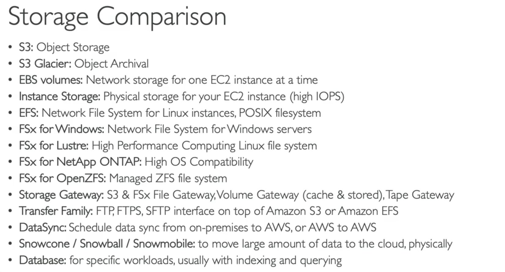

# All Storage Compare in ONE



This is probably the **highest-value storage topic** in the AWS SAA-C03 exam.

Almost every storage question can be solved by asking just **5 questions**:

```
1. What type of data?
   ├── Object → S3
   ├── File → EFS / FSx
   ├── Block → EBS
   └── Database → RDS/DynamoDB/etc.

2. Where is it running?
   ├── EC2
   ├── On-premises
   └── Global users

3. How fast?
   ├── Normal
   ├── Very Fast
   └── Ultra High Performance

4. Is it shared?
   ├── One EC2
   └── Many servers

5. Is it active or archive?
```

If you answer these 5 questions, you'll almost always choose the correct AWS storage service.

---

# AWS Storage Family Overview

```
                              AWS STORAGE

                ┌────────────────────────────────────┐
                │                                    │
         ACTIVE STORAGE                     DATA MOVEMENT
                │                                    │
                │                                    │
      ┌─────────┼──────────┐               ┌─────────┼─────────┐
      │         │          │               │         │         │
   Object     Block      File          Gateway   DataSync   Transfer
      │         │          │
      │         │          │
      │         │          │
      S3       EBS     EFS / FSx

                 ARCHIVE

              S3 Glacier
```

---

# First Understand Storage Types

Everything becomes easy after this.

---

# 1. Object Storage

Think

```
Photo

Video

PDF

Backup

Logs

Documents
```

Stored as

Objects

NOT disks.

NOT folders.

AWS Service

✅ S3

---

Analogy

Google Drive.

Dropbox.

---

Example

```
photo.jpg

resume.pdf

movie.mp4
```

---

# 2. Block Storage

Think

Hard Disk.

SSD.

Windows C Drive.

Linux /

AWS

EBS

---

Example

```
Ubuntu OS

Database

Application
```

Needs a disk.

---

# 3. File Storage

Think

Shared Folder.

```
HR

Finance

Projects
```

Many servers use same files.

AWS

EFS

or

FSx.

---

# Storage Decision Flow

```
Need disk?

↓

EBS

-------------------

Need shared folder?

↓

EFS / FSx

-------------------

Need photos/videos?

↓

S3

-------------------

Need archive?

↓

Glacier
```

---

# 1. Amazon S3

## Think

Internet Storage.

Unlimited.

Stores Objects.

---

Example

```
photo.jpg

movie.mp4

backup.zip

resume.pdf
```

---

Architecture

```
User

↓

Upload

↓

Amazon S3
```

---

Best Use Cases

✅ Website Images

✅ Logs

✅ Backups

✅ Static Website

✅ Videos

---

Never use S3 for

Operating System

Databases

Boot Volume

---

Exam Scenario

Store

10 million images.

Answer

S3.

---

# 2. S3 Glacier

Exactly same as S3

BUT

Archive.

Cheap.

Slow retrieval.

---

Think

Bank records.

Medical records.

Government archive.

---

Example

Need to keep

Invoices

for

10 years.

Rarely accessed.

↓

Glacier.

---

# 3. Amazon EBS

Think

Hard Disk

attached to

ONE EC2.

---

Diagram

```
EC2

↓

EBS Volume
```

Cannot

normally

attach

same EBS

to

100 EC2.

---

Good For

Operating System

Databases

Applications

---

Exam

Need

Linux boot disk.

↓

EBS.

---

# 4. Instance Store

People confuse this.

Instance Store

is

physical SSD

inside

host machine.

---

Fastest storage.

BUT

If EC2 dies

↓

Everything gone.

---

Think

RAM

but

Disk.

---

Example

Video Rendering

Temporary Cache

Scratch Data

---

Never store

Important Data.

---

# 5. Amazon EFS

Think

Shared Linux Folder.

---

Diagram

```
EC2

EC2

EC2

↓

Amazon EFS
```

All servers

share

same files.

---

Supports

Linux

Only.

---

Example

WordPress

Multiple EC2

Need same uploads folder.

↓

EFS.

---

# 6. FSx Windows

Think

Windows Network Drive.

Supports

SMB

NTFS

Active Directory.

---

Example

```
\\Company\HR
```

Exactly.

---

# 7. FSx Lustre

Think

Supercomputer Storage.

---

Use Cases

AI

Machine Learning

HPC

Video Rendering

Scientific Computing

---

Reads directly

from

S3.

---

# 8. FSx NetApp

Think

Enterprise Storage.

Supports

SMB

NFS

iSCSI.

---

Extra Features

Snapshots

Compression

Deduplication

Replication

---

Existing NetApp customers.

---

# 9. FSx OpenZFS

Think

Managed

ZFS.

---

For companies

already using

OpenZFS.

---

# 10. Storage Gateway

Think

Bridge

between

On-Prem

and

AWS.

---

Example

Office

↓

Gateway

↓

S3.

---

Types

S3 File

FSx File

Volume

Tape.

---

# 11. Transfer Family

Think

FTP Server.

---

Customer

↓

SFTP

↓

AWS

↓

S3.

---

# 12. DataSync

Think

Migration Tool.

---

Move

500 TB

↓

S3.

---

Schedule

Daily.

---

# 13. Snow Family

Think

Internet

too slow.

AWS

ships

hardware.

---

Snowcone

Small

Portable.

---

Snowball

Large

PB

Migration.

---

Snowmobile

Exabytes.

Truck.

---

# 14. Database

Sometimes

Storage isn't enough.

Need

Search

Index

SQL.

↓

Database.

---

# Master Comparison Table

| Service | Storage Type | Shared? | Best For | Performance | Supports | Typical Users |
| --- | --- | --- | --- | --- | --- | --- |
| **S3** | Object | Global | Images, Videos, Backups | High | Everyone | Web Apps |
| **S3 Glacier** | Archive Object | Global | Long-term archive | Slow Retrieval | Everyone | Compliance |
| **EBS** | Block | ❌ One EC2 | OS, Database | Very High | EC2 | Applications |
| **Instance Store** | Local Block | ❌ | Temporary Fast Storage | Extremely High | EC2 | HPC |
| **EFS** | File | ✅ Many Linux EC2 | Shared Linux Files | High | Linux | Web Servers |
| **FSx Windows** | File | ✅ | Windows Shared Drive | High | Windows | Enterprises |
| **FSx Lustre** | File | ✅ | HPC, AI, ML | Extremely High | Linux | Scientists |
| **FSx NetApp** | File | ✅ | Enterprise NAS | Very High | Windows/Linux | Large Enterprises |
| **FSx OpenZFS** | File | ✅ | ZFS Workloads | Very High | Linux | Existing ZFS Users |
| **Storage Gateway** | Hybrid | Yes | On-prem Integration | High | On-prem | Hybrid Cloud |
| **Transfer Family** | File Transfer | N/A | FTP/SFTP Upload | High | External Users | Partners |
| **DataSync** | Migration | N/A | Scheduled Sync | Up to 10 Gbps | All Storage | Admins |
| **Snow Family** | Physical Transfer | N/A | Massive Migration | Offline | PB/EB | Enterprises |
| **Database** | Structured Data | Yes | Queries & Transactions | High | Applications | Business Apps |

---

# Performance Ranking

```
Fastest

Instance Store

↓

FSx Lustre

↓

EBS

↓

FSx NetApp

↓

FSx Windows

↓

EFS

↓

S3

↓

Glacier
```

---

# Cost Ranking

```
Cheapest

Glacier Deep Archive

↓

Glacier

↓

S3 IA

↓

S3 Standard

↓

EFS

↓

FSx

↓

EBS

↓

Instance Store
```

(Instance Store itself has no separate storage charge, but it comes with the EC2 instance type, so higher-performance instances generally cost more.)

---

# Which Service for Which Scenario?

| Scenario | Service | Why |
| --- | --- | --- |
| Store 100 million images | S3 | Object storage, virtually unlimited scalability |
| Keep tax records for 10 years | Glacier | Low-cost archival storage |
| Linux OS boot disk | EBS | Persistent block storage for EC2 |
| Temporary scratch space during video rendering | Instance Store | Extremely fast local storage; data loss is acceptable |
| WordPress uploads shared across multiple Linux EC2 instances | EFS | Shared NFS file system |
| Windows company shared folders | FSx Windows | SMB, NTFS, Active Directory integration |
| Machine Learning reading petabytes from S3 | FSx Lustre | Ultra-high throughput with S3 integration |
| Enterprise already uses NetApp ONTAP | FSx NetApp | Same enterprise storage features in AWS |
| Existing applications depend on OpenZFS | FSx OpenZFS | Native ZFS compatibility |
| Connect on-premises file servers to AWS storage | Storage Gateway | Hybrid storage bridge |
| Business partners upload files using SFTP | Transfer Family | Managed FTP/FTPS/SFTP endpoints |
| Synchronize 500 TB from on-premises NAS to S3 | DataSync | High-speed migration with metadata preservation |
| Move 5 PB where internet is too slow | Snowball | Physical data transfer device |
| Need SQL queries, indexes, and transactions | Database | Purpose-built for querying and transactional workloads |

---

# The Ultimate AWS Storage Decision Tree (SAA-C03)

```
Need SQL queries?
        │
        └── Database

Need to move petabytes physically?
        │
        └── Snow Family

Need scheduled migration/synchronization?
        │
        └── DataSync

Need FTP/SFTP access?
        │
        └── Transfer Family

Need to connect on-premises storage to AWS?
        │
        └── Storage Gateway

Need to archive data?
        │
        └── S3 Glacier

Need object storage (photos, videos, backups)?
        │
        └── S3

Need a disk for an EC2 instance?
        │
        ├── Temporary, highest speed → Instance Store
        └── Persistent → EBS

Need a shared file system?
        │
        ├── Linux → EFS
        ├── Windows shared folders → FSx Windows
        ├── AI / HPC / S3 integration → FSx Lustre
        ├── Existing NetApp environment → FSx NetApp ONTAP
        └── Existing OpenZFS environment → FSx OpenZFS
```

## 🎯 The 10-Second Exam Rule

When you see an exam question, identify the key requirement first:

- 🖼️ **Objects (images, videos, backups)** → **S3**
- 🧊 **Archive** → **Glacier**
- 💽 **One EC2 disk** → **EBS**
- ⚡ **Temporary ultra-fast local storage** → **Instance Store**
- 📁 **Shared Linux files** → **EFS**
- 🪟 **Windows shared drive** → **FSx Windows**
- 🚀 **Machine Learning / HPC / S3 integration** → **FSx Lustre**
- 🏢 **Enterprise NetApp workloads** → **FSx NetApp ONTAP**
- 🐧 **Existing OpenZFS workloads** → **FSx OpenZFS**
- 🌉 **Hybrid on-premises + AWS storage** → **Storage Gateway**
- 📤 **FTP/FTPS/SFTP** → **Transfer Family**
- 🔄 **Migration or scheduled synchronization** → **DataSync**
- 🚚 **Petabytes over physical devices** → **Snow Family**
- 🗃️ **Structured data with SQL and indexing** → **Database**

If you start by identifying **the type of storage problem** rather than the AWS service name, the correct answer usually becomes obvious.
