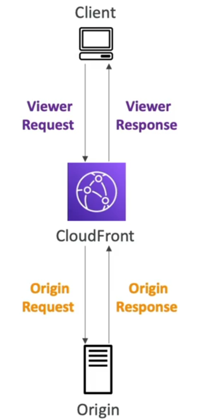
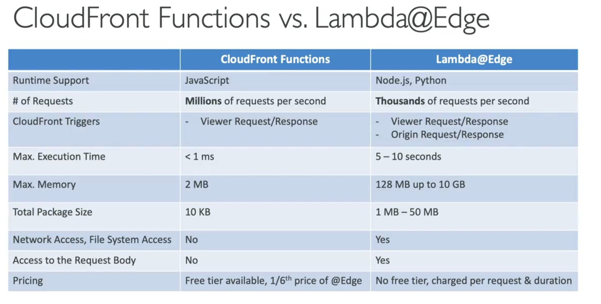

# Lambda SnapStart & Customization at the Edge (AWS SAA-C03)

These are **two separate topics**. They are often tested with **scenario-based questions**.

---

# Part 1 — Lambda SnapStart

Before learning SnapStart, remember this:

## Normal Lambda Execution

Suppose nobody calls your Lambda for a while.

AWS removes its execution environment.

The next request arrives.

AWS must do this:

```
Request

↓

Create New Environment

↓

Start Runtime

↓

Load Code

↓

Load Libraries

↓

Initialize SDK

↓

Run Function
```

This initialization takes time.

This is called a **Cold Start**.

---

# What is SnapStart?

Think of a video game.

Instead of starting from the beginning every time,

You save the game.

Next time,

You load the save file.

That's exactly what SnapStart does.

---

## Without SnapStart

```
Request

↓

Create Environment

↓

Load Runtime

↓

Load Libraries

↓

Initialize Code

↓

Run
```

Slow.

---

## With SnapStart

AWS already saved the initialized environment.

```
Request

↓

Restore Snapshot

↓

Run
```

Much faster.

---

# How SnapStart Works

Suppose you publish Version 1 of your Lambda.

AWS automatically does this:

```
Publish Version

↓

Start Lambda Once

↓

Load Runtime

↓

Load Libraries

↓

Initialize Everything

↓

Take Snapshot 📸

↓

Save Snapshot
```

Later,

when requests come,

AWS simply restores the snapshot.

```
User Request

↓

Restore Snapshot

↓

Run Function
```

No full initialization again.

---

# Real-Life Analogy

Imagine Microsoft Word.

Normally

```
Open Word

↓

Load Fonts

↓

Load Plugins

↓

Ready
```

Maybe 8 seconds.

Now imagine Windows saved everything already.

```
Double Click

↓

Instant Restore

↓

Ready
```

That's SnapStart.

---

# Why SnapStart?

Cold Starts are mainly caused by

- Large libraries
- Java startup
- .NET startup
- SDK initialization
- Dependency loading

SnapStart skips most of this work.

---

# Performance

AWS says

> Up to **10× faster startup** (depending on runtime and workload).
> 

Very useful for APIs where latency matters.

---

# SnapStart Workflow

```
Publish Version

↓

Initialize Lambda

↓

Take Snapshot

↓

Store Snapshot

↓

Later...

↓

Restore Snapshot

↓

Execute Function
```

---

# SnapStart vs Provisioned Concurrency

Many students confuse these.

---

## Provisioned Concurrency

Keeps Lambda environments

already running.

Think

Restaurant

```
Chef Already Standing

↓

Customer Arrives

↓

Cook Immediately
```

You pay to keep them warm.

---

## SnapStart

Instead,

AWS stores a snapshot.

Think

```
Kitchen Saved

↓

Restore Kitchen

↓

Cook
```

No need to initialize from scratch.

---

# Comparison

| Provisioned Concurrency | SnapStart |
| --- | --- |
| Keeps environments warm | Restores from a snapshot |
| Eliminates almost all cold starts | Greatly reduces initialization time |
| Resources remain allocated | Snapshot is restored when needed |
| Better for consistently low latency | Good when you want faster starts without keeping environments warm |
| Can cost more because environments stay ready | No additional SnapStart charge (runtime support and pricing depend on AWS) |

---

# Exam Tips

If the question says:

> **Reduce Java/Python/.NET cold start without manually warming Lambda**
> 

Think

✅ SnapStart

---

If the question says

> **Keep functions always ready for immediate execution**
> 

Think

✅ Provisioned Concurrency

---

# Memory Trick

## Provisioned Concurrency

> **Keep Warm**
> 

---

## SnapStart

> **Save State → Restore Later**
> 

---

# Part 2 — Customization at the Edge

First understand

## What is "Edge"?

Suppose your website is hosted in

```
Virginia (USA)
```

A user from Japan opens it.

Without CloudFront

```
Japan

↓

USA

↓

Japan
```

Long distance.

Higher latency.

---

With CloudFront

```
Japan

↓

CloudFront Japan

↓

Fast Response
```

CloudFront has edge locations around the world.

---

# Edge Functions

Sometimes,

you want to run code

BEFORE

The request reaches your server.

Example

```
User

↓

CloudFront

↓

Run Small Code

↓

Website
```

This small code is called an

**Edge Function**.

---

# Why Run Code at the Edge?

Suppose

User requests

```
/login
```

Instead of sending every request to your origin,

CloudFront can

- Check authentication
- Redirect users
- Block countries
- Rewrite URLs
- Modify headers

All before the origin is contacted.

Faster.

---

# AWS Provides Two Edge Services

```
CloudFront

├── CloudFront Functions
└── Lambda@Edge
```

This is one of the most tested comparisons.

---

# CloudFront Functions

Think

Tiny JavaScript.

Very Fast.

Very Simple.

---

It only changes

```
Request

or

Response
```

Example

User requests

```
/about
```

CloudFront changes it to

```
/website/about
```

Origin never notices.

---

# Real Example

User

```
example.com
```

CloudFront Function adds

```
Country Header

Language Header
```

Very fast.

---

# Characteristics

- JavaScript only
- Extremely fast
- Millions of requests per second
- Very small execution time
- Runs entirely inside CloudFront

---

# What Can It Modify?

Only

### Viewer Request

When request arrives.

```
User

↓

CloudFront Function

↓

Origin
```

---

### Viewer Response

Before sending response back.

```
Origin

↓

CloudFront Function

↓

User
```

---

# Typical Use Cases

- URL rewrite
- Redirect
- Header manipulation
- Cookie changes
- JWT validation
- Cache key normalization

Very lightweight work.

---

# Lambda@Edge

Sometimes

CloudFront Function isn't enough.

Need

- Python
- Node.js
- AWS SDK
- Database access
- Call another API
- Read request body

Use

Lambda@Edge.

---

# Lambda@Edge Flow



It can run at four different stages.

```
User

↓

Viewer Request

↓

CloudFront

↓

Origin Request

↓

Origin

↓

Origin Response

↓

CloudFront

↓

Viewer Response

↓

User
```

This is very important for the exam.

---

# Four Trigger Points

## 1. Viewer Request

Immediately after

CloudFront receives request.

Example

```
User

↓

Viewer Request

↓

Check JWT
```

---

## 2. Origin Request

Before CloudFront contacts origin.

Example

```
CloudFront

↓

Choose Different Origin
```

---

## 3. Origin Response

Origin replies.

Lambda modifies response.

Example

```
Add Security Headers
```

---

## 4. Viewer Response

Before user receives response.

Example

```
Compress Response

↓

User
```

---

# Lambda@Edge Characteristics

Supports

- Node.js
- Python

Can

- Access AWS SDK
- Access external APIs
- Read request body
- Use third-party libraries
- Run longer than CloudFront Functions
- Allocate more CPU and memory

---

# Example

User uploads image.

```
User

↓

Lambda@Edge

↓

Resize Image

↓

Return Image
```

CloudFront Functions cannot perform this type of processing.

---

# CloudFront Functions vs Lambda@Edge

| CloudFront Functions | Lambda@Edge |
| --- | --- |
| JavaScript only | Node.js & Python |
| Extremely fast | Slower but more powerful |
| Lightweight | Full Lambda capabilities |
| Viewer Request & Viewer Response | Viewer Request, Origin Request, Origin Response, Viewer Response |
| No network calls | Can call AWS services or external APIs |
| No request body access | Can access request body |
| No third-party libraries | Supports third-party libraries |
| Best for header, cookie, URL changes | Best for authentication, image processing, API calls, dynamic logic |

---



# Easy Analogy

Imagine airport security.

### CloudFront Functions

Security guard.

Can

- Check passport
- Redirect passenger
- Change gate

Very quick.

---

### Lambda@Edge

Airport manager.

Can

- Call another airport
- Change flights
- Access databases
- Verify tickets
- Handle complex situations

Much more powerful.

---

# Which One Should I Choose?

## Choose CloudFront Functions

If you need

- URL rewrite
- Redirect
- Header changes
- Cookie changes
- Cache key normalization
- JWT validation
- Very low latency

---

## Choose Lambda@Edge

If you need

- AWS SDK
- Database/API calls
- Third-party libraries
- Image transformation
- Read request body
- Dynamic origin routing
- Complex authentication

---

# AWS SAA-C03 Cheat Sheet

| Topic | Remember |
| --- | --- |
| **SnapStart** | Saves an initialized Lambda snapshot to speed up future starts |
| **Cold Start** | Runtime and code initialization before execution |
| **Provisioned Concurrency** | Keeps execution environments warm |
| **CloudFront Functions** | Tiny, ultra-fast JavaScript for viewer request/response customization |
| **Lambda@Edge** | Full Lambda logic running at CloudFront edge locations |
| **Viewer Request** | Before CloudFront checks or serves content to the viewer |
| **Origin Request** | Before CloudFront forwards the request to the origin |
| **Origin Response** | After the origin responds, before CloudFront caches/forwards it |
| **Viewer Response** | Before CloudFront sends the response back to the viewer |

---

# Exam Memory Tricks

### 📸 SnapStart

> **"Take a picture after initialization."**
> 

Later,

AWS restores the picture instead of initializing everything again.

---

### ⚡ CloudFront Functions

> **"Small and Super Fast."**
> 

Think:

- JavaScript
- Headers
- Cookies
- URL rewrites
- Cache keys

---

### 🚀 Lambda@Edge

> **"Full Lambda at the Edge."**
> 

Think:

- Python / Node.js
- AWS SDK
- API calls
- Image processing
- Complex authentication
- Four CloudFront trigger points

---

## One Final Rule for the Exam

When you see:

- **"Very high request rate, simple header or URL modification, ultra-low latency"** → **CloudFront Functions**
- **"Need external services, AWS SDK, request body, third-party libraries, or complex business logic at CloudFront"** → **Lambda@Edge**
- **"Reduce Lambda startup time by restoring a pre-initialized execution state"** → **SnapStart**
- **"Keep execution environments already running for consistently low latency"** → **Provisioned Concurrency**
