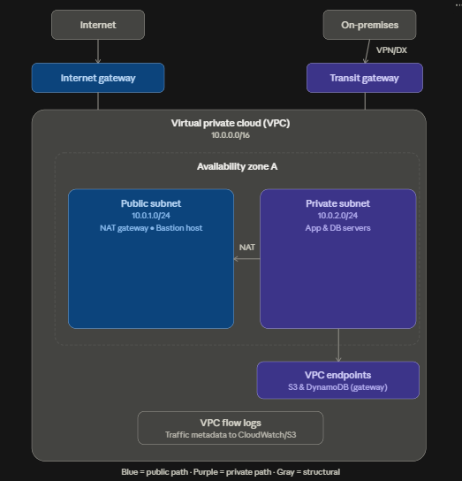
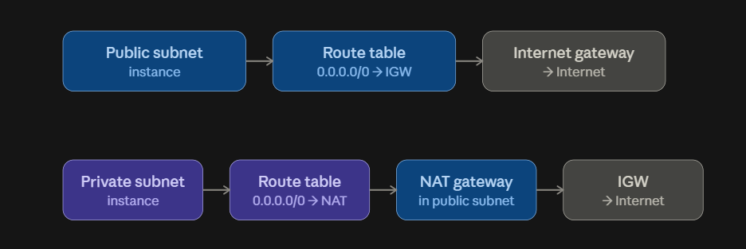
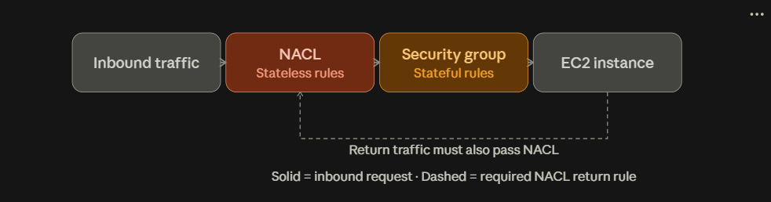
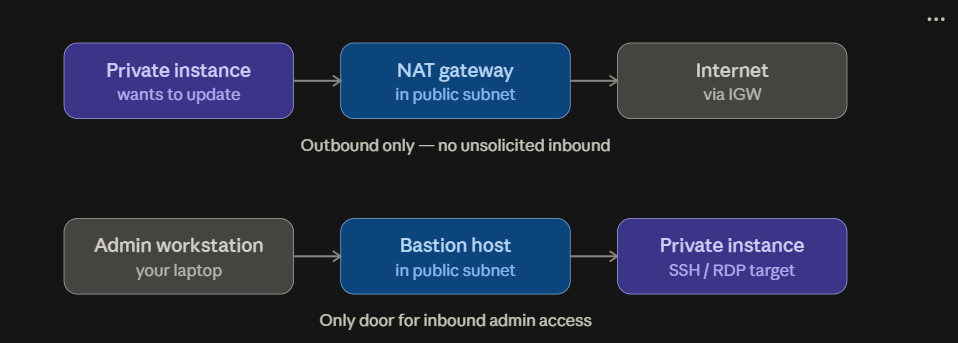
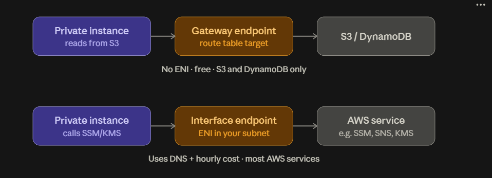
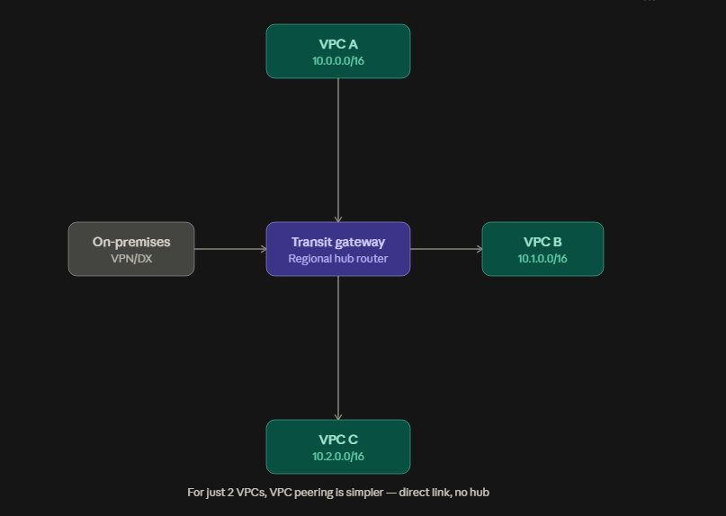

# Response 1

Here's the full picture of how a VPC and all its pieces connect — one master diagram showing everything together, then five focused diagrams breaking down each connection in detail.

## The master diagram

This shows the whole path: internet and on-premises networks in, through the gateways, into the VPC, across subnets, down to the endpoints and logs.That's the whole system in one shot. Notice what's *not* labeled explicitly there — route tables, security groups, and NACLs — those are the invisible rules that decide whether traffic is even allowed to follow these paths. The five diagrams below fill in exactly that.

### 1. Route tables — why public and private subnets behave differently

A subnet is only "public" or "private" because of what its route table points to. Nothing else makes it so.

A route table is just a list of destinations and "next hop" targets, attached per subnet. Change one row in that table and you've changed what the subnet *is* — no other setting defines "public" vs "private."

### 2. Security groups vs NACLs — the two firewalls every packet passes through

Every packet entering a subnet passes both layers, but they behave completely differently: NACLs are stateless (they don't remember a connection, so return traffic needs its own explicit rule), security groups are stateful (allow the request in, and the reply is automatically allowed back out).

That "return traffic" gotcha is the single most common NACL misconfiguration — people forget the outbound rule and wonder why a connection times out even though inbound looks fine.

### 3. NAT gateway vs bastion host — two different jobs, same subnet

Both live in the public subnet, but they solve opposite problems: NAT gives private instances a way *out* to the internet; the bastion is the only way *in* for an admin to reach those same private instances.

(A Systems Manager Session Manager connection is the modern replacement for a bastion host — same job, no open SSH port at all — worth knowing about if you're designing this fresh.)

### 4. VPC endpoints — reaching AWS services without touching the internet

Two flavors, and they work differently. A gateway endpoint is free and is literally just a special row in your route table (only S3 and DynamoDB support it). An interface endpoint drops an actual network interface with a private IP into your subnet and works for most other AWS services, but costs an hourly fee.

Interface endpoints are what's usually called "AWS PrivateLink" — it's the same mechanism third-party SaaS vendors use to expose their service into your VPC privately too.

### 5. Transit gateway — the hub connecting many VPCs and on-premises

Once you have more than two or three VPCs, connecting each pair directly (peering) turns into an unmanageable mesh. A transit gateway is a regional router that every VPC and your on-premises network attach to once, and it routes between all of them.###

Putting it all together

Reading the master diagram now: a request from the internet hits the **IGW**, enters the **VPC**, gets checked by the subnet's **NACL** then the instance's **security group**, and lands on whatever's in the **public subnet**. If that public-subnet resource is a **NAT gateway**, private-subnet instances use it to reach *out*; if it's a **bastion host**, admins use it to reach *in*. Private instances that need AWS services skip the internet path entirely via a **VPC endpoint**. Everything that crosses an ENI gets recorded by **flow logs**. And a **transit gateway** is how this whole VPC talks to its siblings and to on-premises, instead of a tangle of direct peering links.

A few more pieces that exist but weren't diagrammed above, since you asked if anything's left out:

- **VPC peering** — a direct 1:1 connection between two VPCs, simpler than a transit gateway but doesn't scale past a few VPCs (no transitive routing).
- **Elastic IP / ENI** — a static public IP and the actual virtual network card attached to an instance; NAT gateways and interface endpoints are both really just ENIs under the hood.
- **Egress-only internet gateway** — the IPv6 equivalent of a NAT gateway (outbound only, stateless).
- **Site-to-Site VPN / Direct Connect** — the two ways "on-premises" actually reaches the transit gateway or VPC; VPN is encrypted-over-internet, Direct Connect is a dedicated physical line.
- **DHCP option sets & Route 53 Resolver** — control DNS resolution inside the VPC.
- **VPC sharing (RAM)** — lets multiple AWS accounts use subnets in one shared VPC.
- **Network Firewall / Reachability Analyzer** — an optional deep-packet-inspection layer, and a diagnostic tool that traces whether a path *should* work given all these route tables, SGs, and NACLs.
