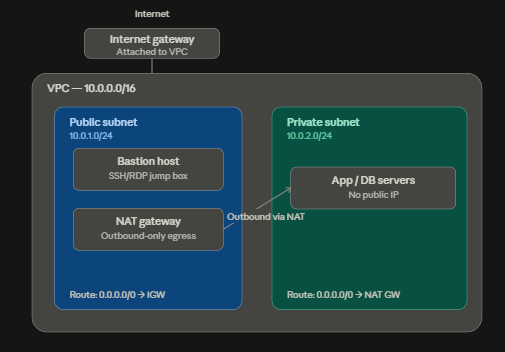
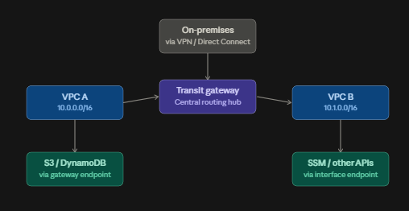
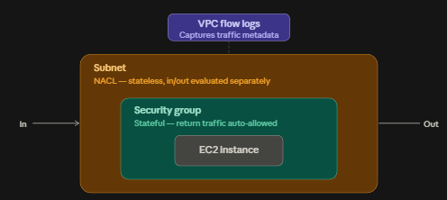

# How a VPC connects to everything around it

A VPC is really just an isolated network (a CIDR block, e.g. `10.0.0.0/16`) that becomes useful once you attach the right pieces to it. Let me walk through it in three layers: (1) the VPC itself — subnets, route tables, IGW, NAT, bastion; (2) how VPCs talk to the outside world and each other — endpoints and Transit Gateway; (3) the security/monitoring layers — SG, NACL, Flow Logs.

## 1. Inside a single VPC

**What's happening here:**

- The **internet gateway (IGW)** is attached to the VPC (one per VPC) and is the only door to the public internet.
- Each subnet is tied to a **route table**. The public subnet's route table sends `0.0.0.0/0` to the IGW — that's what makes it "public." The private subnet's route table instead sends `0.0.0.0/0` to the **NAT gateway**, which lives in the public subnet, has an Elastic IP, and lets private instances reach the internet (for updates, packages, etc.) without being reachable from it.
- The **bastion host** sits in the public subnet with a public IP; admins SSH/RDP into it first, then hop into private instances — so private instances never need a direct route from the internet.
- Route tables, not physical wiring, are what actually make a subnet "public" or "private" — swap the route table and the label changes.

## 2. Connecting VPCs to each other and to AWS services

**How this connects:**

- A **Transit Gateway (TGW)** is a regional hub — each VPC (and your on-prem network via VPN/Direct Connect) attaches to it once, and the TGW's own route tables decide who can reach whom. This replaces messy full-mesh VPC peering when you have many VPCs.
- **VPC endpoints** let instances in a private subnet reach AWS services without going through the IGW or NAT at all:
    - **Gateway endpoints** (S3, DynamoDB only) work by adding a target in the route table — free, no ENI.
    - **Interface endpoints** (most other services — SSM, KMS, Secrets Manager, etc.) create an ENI with a private IP inside your subnet, and traffic reaches it over AWS's private network (PrivateLink).
- Traffic to S3/DynamoDB never has to leave AWS's backbone, which is both faster and avoids NAT Gateway data-processing charges.

## 3. Security layers and visibility

**Two very different filters, plus visibility:**

- **NACLs** sit at the subnet boundary, are **stateless** (you must explicitly allow both the request and its response), evaluate rules in numbered order, and can explicitly **deny** traffic.
- **Security groups** sit at the instance/ENI boundary, are **stateful** (return traffic is auto-allowed), and only support **allow** rules — everything else is implicitly denied.
- Every packet entering or leaving an instance in a subnet passes through the NACL first, then the SG.
- **VPC Flow Logs** don't sit in the traffic path — they passively record metadata (source/dest IP, port, protocol, ACCEPT/REJECT, bytes) at the ENI, subnet, or whole-VPC level, and ship it to CloudWatch Logs or S3 for auditing/troubleshooting.

## Putting it all together — a request's journey

1. A user on the internet hits your bastion or a public-facing load balancer → **IGW** → **route table** sends it into the **public subnet** → **NACL** → **SG** → instance.
2. That public instance (or an app server) needs to call an external API or download packages → private/public route table sends `0.0.0.0/0` → **NAT gateway** → **IGW** → internet.
3. An app server needs to read from S3 → route table sends the S3 prefix range to the **gateway endpoint** — traffic never touches NAT or the IGW.
4. An app server needs to talk to a service in another VPC or on-prem → route table sends it to the **Transit Gateway**, which forwards it based on its own attachment/route tables.
5. The whole time, **NACLs and SGs** are gatekeeping every hop, and **Flow Logs** are quietly recording what passed and what got blocked.

Since you're studying for SAA-C03, the exam tends to test exactly these distinctions — NACL vs SG statefulness, when a subnet is "public" (it's the route table, not the subnet itself), gateway vs interface endpoints, and TGW vs peering for multi-VPC designs. Want me to turn this into a quick practice quiz on VPC networking?
