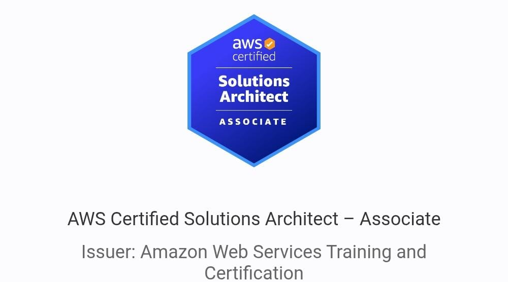
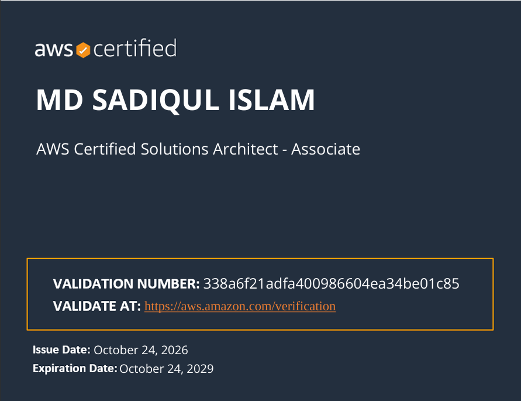

<p align="center"></p>
<p align="center"></p> 

# AWS Solutions Architect Associate (SAA-C03) Notes

> My personal study notes for the **AWS Certified Solutions Architect - Associate (SAA-C03)** exam, written while working hands-on with AWS and organized by topic so you can jump straight to what you need.


## How to use this repo

1. Pick a topic from the table below, or the full index further down.
2. Each folder has its own `README.md` listing its subtopics.
3. Every note is a plain Markdown file, so you can read, search, and copy it freely.
4. Found a mistake or a missing comparison? Open an issue or a pull request.

## Topics at a glance

| # | Topic | Contents |
|---|-------|----------|
| 01 | 📁 [Getting Started with AWS](01-getting-started-with-aws/README.md) | outline only (notes coming soon) |
| 02 | 📁 [IAM & AWS CLI](02-iam-and-aws-cli/README.md) | 2 notes |
| 03 | 📁 [EC2 All Levels](03-ec2-all-levels/README.md) | 30 notes |
| 04 | 📁 [Load Balancer](04-load-balancer/README.md) | 16 notes |
| 05 | 📁 [Auto Scaling Groups](05-auto-scaling-groups/README.md) | 5 notes |
| 06 | 📁 [RDS details](06-rds-details/README.md) | 12 notes |
| 07 | 📁 [Aurora details](07-aurora-details/README.md) | 7 notes |
| 08 | 📁 [AWS All DB Services compare in ONE](08-aws-all-db-services-compare-in-one/README.md) | 2 notes |
| 09 | 📁 [ElastiCache](09-elasticache/README.md) | 3 notes |
| 10 | 📁 [Route 53](10-route-53/README.md) | 10 notes |
| 11 | 📁 [Classic Solution Architect](11-classic-solution-architect/README.md) | 1 note |
| 12 | 📄 [Elastic Beanstalk](12-elastic-beanstalk.md) | 1 note |
| 13 | 📁 [S3 All Levels](13-s3-all-levels/README.md) | 31 notes |
| 14 | 📁 [CloudFront](14-cloudfront/README.md) | 28 notes |
| 15 | 📁 [Global Accelerator](15-global-accelerator/README.md) | 2 notes |
| 16 | 📁 [AWS Storage Extras](16-aws-storage-extras/README.md) | 19 notes |
| 17 | 📁 [AWS Integration & Message (SQS, SNS, Kinesis)](17-aws-integration-and-message-sqs-sns-kinesis/README.md) | 23 notes |
| 18 | 📁 [AWS ECS, Fargate, ECR & EKS](18-aws-ecs-fargate-ecr-and-eks/README.md) | 10 notes |
| 19 | 📁 [Serverless](19-serverless/README.md) | 20 notes |
| 20 | 📁 [Databases in AWS](20-databases-in-aws/README.md) | 13 notes |
| 21 | 📁 [Data & Analytics](21-data-and-analytics/README.md) | 12 notes |
| 22 | 📁 [Machine Learning](22-machine-learning/README.md) | 15 notes |
| 23 | 📁 [AWS Monitoring and Audit](23-aws-monitoring-and-audit/README.md) | 12 notes |
| 24 | 📁 [IAM Advanced](24-iam-advanced/README.md) | 10 notes |
| 25 | 📁 [Security & Encryption KMS, SSM Parameter Store, Shield, WAF](25-security-and-encryption-kms-ssm-parameter-store-shield-waf/README.md) | 27 notes |
| 26 | 📁 [VPC](26-vpc/README.md) | 46 notes |
| 27 | 📁 [Disaster Recovery & Migrations](27-disaster-recovery-and-migrations/README.md) | 9 notes |
| 28 | 📁 [More solution architects (important exam scenario)](28-more-solution-architects-important-exam-scenario/README.md) | 7 notes |
| 29 | 📁 [Other Services (Rare)](29-other-services-rare/README.md) | 12 notes |
| 30 | 📁 [White Papers and Architectures](30-white-papers-and-architectures/README.md) | 5 notes |
| 31 | 📄 [Exam Review & Tips](31-exam-review-and-tips.md) | 1 note |
| 32 | 📁 [All services: Master Table](32-all-services-master-table/README.md) | 1 note |
| 33 | 📁 [New Keywords List](33-new-keywords-list/README.md) | 101 notes |
| 34 | 📄 [Resources](34-resources.md) | 1 note |

## Full index

- 📁 **[Getting Started with AWS](01-getting-started-with-aws/README.md)**
  - ▫️ AWS Cloud Overview - Regions & AZ
  - ▫️ Important AWS Console UI Update
  - ▫️ Tour of the AWS Console & Services in AWS
- 📁 **[IAM & AWS CLI](02-iam-and-aws-cli/README.md)**
  - ▫️ IAM Introduction: Users, Groups, Policies
  - ▫️ IAM Users & Groups
  - ▫️ IAM Policies
  - ▫️ IAM MFA Overview
  - ▫️ AWS Access Keys, CLI and SDK
  - ▫️ AWS CLI Setup on Windows
  - ▫️ AWS CLI Setup on Mac OS X
  - ▫️ AWS CLI Setup on Linux
  - ▫️ AWS CloudShell
  - 📁 **[IAM Roles for AWS Services](02-iam-and-aws-cli/10-iam-roles-for-aws-services/README.md)**
    - 📄 [Part: 1](02-iam-and-aws-cli/10-iam-roles-for-aws-services/01-part-1.md)
    - 📄 [Part: 2](02-iam-and-aws-cli/10-iam-roles-for-aws-services/02-part-2.md)
  - ▫️ IAM Security Tools
  - ▫️ IAM Best Practices
  - ▫️ IAM Summary
- 📁 **[EC2 All Levels](03-ec2-all-levels/README.md)**
  - 📁 **[EC2 Fundamentals](03-ec2-all-levels/01-ec2-fundamentals/README.md)**
    - ▫️ AWS Budget Setup
    - ▫️ EC2 Basics
    - ▫️ Create an EC2 Instance with EC2 User Data to have a Website
    - 📄 [EC2 Instance Types: Basics](03-ec2-all-levels/01-ec2-fundamentals/04-ec2-instance-types-basics.md)
    - 📄 [Security Groups & Classic Ports Overview](03-ec2-all-levels/01-ec2-fundamentals/05-security-groups-and-classic-ports-overview.md)
    - ▫️ SSH Overview
    - 📄 [How to SSH using Linux or Mac Windows](03-ec2-all-levels/01-ec2-fundamentals/07-how-to-ssh-using-linux-or-mac-windows.md)
    - ▫️ SSH Troubleshooting
    - 📄 [EC2 Instance Connect](03-ec2-all-levels/01-ec2-fundamentals/09-ec2-instance-connect.md)
    - ▫️ EC2 Instance Roles Demo
    - 📄 [EC2 Instance Purchasing Options](03-ec2-all-levels/01-ec2-fundamentals/11-ec2-instance-purchasing-options.md)
    - 📄 [Spot Instances & Spot Fleet](03-ec2-all-levels/01-ec2-fundamentals/12-spot-instances-and-spot-fleet.md)
  - 📁 **[EC2 Advanced Level](03-ec2-all-levels/02-ec2-advanced-level/README.md)**
    - 📄 [Private vs Public vs Elastic IP](03-ec2-all-levels/02-ec2-advanced-level/01-private-vs-public-vs-elastic-ip.md)
    - 📄 [EC2 Placement Groups](03-ec2-all-levels/02-ec2-advanced-level/02-ec2-placement-groups.md)
    - 📄 [Elastic Network Interfaces (ENI) - Overview](03-ec2-all-levels/02-ec2-advanced-level/03-elastic-network-interfaces-eni-overview.md)
    - 📄 [EC2 Hibernate](03-ec2-all-levels/02-ec2-advanced-level/04-ec2-hibernate.md)
  - 📁 **[EC2 Instance Storage](03-ec2-all-levels/03-ec2-instance-storage/README.md)**
    - 📄 [EBS Overview](03-ec2-all-levels/03-ec2-instance-storage/01-ebs-overview.md)
    - 📄 [EBS Snapshots](03-ec2-all-levels/03-ec2-instance-storage/02-ebs-snapshots.md)
    - 📄 [AMI Overview](03-ec2-all-levels/03-ec2-instance-storage/03-ami-overview.md)
    - 📄 [EC2 Instance Store](03-ec2-all-levels/03-ec2-instance-storage/04-ec2-instance-store.md)
    - 📄 [EBS Volume Types](03-ec2-all-levels/03-ec2-instance-storage/05-ebs-volume-types.md)
    - 📄 [EBS Multi-Attach](03-ec2-all-levels/03-ec2-instance-storage/06-ebs-multi-attach.md)
    - 📄 [EBS Encryption](03-ec2-all-levels/03-ec2-instance-storage/07-ebs-encryption.md)
    - 📄 [Amazon EFS & vs EBS](03-ec2-all-levels/03-ec2-instance-storage/08-amazon-efs-and-vs-ebs.md)
  - 📄 [EC2 Instance Families — SAA-C03 Master Table](03-ec2-all-levels/04-ec2-instance-families-saa-c03-master-table.md)
  - 📁 **[EC2 COMPLETE NOTES UPDATED](03-ec2-all-levels/05-ec2-complete-notes-updated/README.md)**
    - 📄 [Series Explain](03-ec2-all-levels/05-ec2-complete-notes-updated/01-series-explain.md)
    - 📄 [Part: 1 — EC2 Foundations + AMI](03-ec2-all-levels/05-ec2-complete-notes-updated/02-part-1-ec2-foundations-ami.md)
    - 📄 [Part 2 — EC2 Storage](03-ec2-all-levels/05-ec2-complete-notes-updated/03-part-2-ec2-storage.md)
    - 📄 [Part 3 — EC2 Placement + Networking Performance](03-ec2-all-levels/05-ec2-complete-notes-updated/04-part-3-ec2-placement-networking-performance.md)
    - 📄 [Part 4 — EC2 Purchasing Models](03-ec2-all-levels/05-ec2-complete-notes-updated/05-part-4-ec2-purchasing-models.md)
    - 📄 [Part 5 — EC2 Performance / Special Features](03-ec2-all-levels/05-ec2-complete-notes-updated/06-part-5-ec2-performance-special-features.md)
    - 📄 [Part 6 — EC2 Automation + Scaling Integration](03-ec2-all-levels/05-ec2-complete-notes-updated/07-part-6-ec2-automation-scaling-integration.md)
    - 📄 [Part 7 — EC2 Security + IAM Integration](03-ec2-all-levels/05-ec2-complete-notes-updated/08-part-7-ec2-security-iam-integration.md)
    - 📄 [Part 8 — EC2 Exam Scenario Engine](03-ec2-all-levels/05-ec2-complete-notes-updated/09-part-8-ec2-exam-scenario-engine.md)
    - 📄 [Part 9 — EC2 Mega Comparison Tables](03-ec2-all-levels/05-ec2-complete-notes-updated/10-part-9-ec2-mega-comparison-tables.md)
    - 📄 [Part 10 — Final EC2 5-Minute Exam Sheet](03-ec2-all-levels/05-ec2-complete-notes-updated/11-part-10-final-ec2-5-minute-exam-sheet.md)
- 📁 **[Load Balancer](04-load-balancer/README.md)**
  - 📄 [High Availability and Scalability](04-load-balancer/01-high-availability-and-scalability.md)
  - 📄 [Elastic Load Balancing (ELB) Overview](04-load-balancer/02-elastic-load-balancing-elb-overview.md)
  - 📄 [Note About the Classic Load Balancer (CLB)](04-load-balancer/03-note-about-the-classic-load-balancer-clb.md)
  - 📄 [Application Load Balancer (ALB)](04-load-balancer/04-application-load-balancer-alb.md)
  - 📄 [Network Load Balancer (NLB)](04-load-balancer/05-network-load-balancer-nlb.md)
  - 📄 [Gateway Load Balancer (GWLB)](04-load-balancer/06-gateway-load-balancer-gwlb.md)
  - 📄 [ALB VS NLB VS GLB](04-load-balancer/07-alb-vs-nlb-vs-glb.md)
  - 📄 [Elastic Load Balancer - Sticky Sessions](04-load-balancer/08-elastic-load-balancer-sticky-sessions.md)
  - 📄 [Elastic Load Balancer – Cross-Zone Load Balancing](04-load-balancer/09-elastic-load-balancer-cross-zone-load-balancing.md)
  - 📄 [Elastic Load Balancer - SSL Certificates + SNI](04-load-balancer/10-elastic-load-balancer-ssl-certificates-sni.md)
  - 📄 [Elastic Load Balancer - Connection Draining](04-load-balancer/11-elastic-load-balancer-connection-draining.md)
  - 📁 **[ALB, NLB , GWLB](04-load-balancer/12-alb-nlb-gwlb/README.md)**
    - 📄 [Shortcut](04-load-balancer/12-alb-nlb-gwlb/01-shortcut.md)
  - 📄 [NLB problem](04-load-balancer/13-nlb-problem.md)
  - 📄 [Sticky session](04-load-balancer/14-sticky-session.md)
  - 📄 [SNI: Server Name Indication](04-load-balancer/15-sni-server-name-indication.md)
  - 📄 [Connection Draining](04-load-balancer/16-connection-draining.md)
- 📁 **[Auto Scaling Groups](05-auto-scaling-groups/README.md)**
  - 📄 [Auto Scaling Groups (ASG) Overview](05-auto-scaling-groups/01-auto-scaling-groups-asg-overview.md)
  - 📄 [Auto Scaling Groups - Scaling Policies](05-auto-scaling-groups/02-auto-scaling-groups-scaling-policies.md)
  - 📄 [Table](05-auto-scaling-groups/03-table.md)
  - 📄 [Scaling Policies](05-auto-scaling-groups/04-scaling-policies.md)
  - 📄 [Scaling Cooldowns](05-auto-scaling-groups/05-scaling-cooldowns.md)
- 📁 **[RDS details](06-rds-details/README.md)**
  - 📄 [RDS Read Replica](06-rds-details/01-rds-read-replica.md)
  - 📄 [RDS Multi-AZ](06-rds-details/02-rds-multi-az.md)
  - 📄 [Async Replication vs sync Replication](06-rds-details/03-async-replication-vs-sync-replication.md)
  - 📄 [RDS Proxy](06-rds-details/04-rds-proxy.md)
  - 📄 [RDS Event Subscription](06-rds-details/05-rds-event-subscription.md)
  - 📄 [RDS Enhance Monitoring](06-rds-details/06-rds-enhance-monitoring.md)
  - 📁 **[RDS Security - IAM DB Authentication.](06-rds-details/07-rds-security-iam-db-authentication/README.md)**
    - 📁 **[IAM DB Authentication.](06-rds-details/07-rds-security-iam-db-authentication/01-iam-db-authentication/README.md)**
      - 📄 [1](06-rds-details/07-rds-security-iam-db-authentication/01-iam-db-authentication/01-1.md)
      - 📄 [2](06-rds-details/07-rds-security-iam-db-authentication/01-iam-db-authentication/02-2.md)
      - 📄 [3](06-rds-details/07-rds-security-iam-db-authentication/01-iam-db-authentication/03-3.md)
    - 📄 [Transparent Data Encryption (TDE)](06-rds-details/07-rds-security-iam-db-authentication/02-transparent-data-encryption-tde.md)
  - 📁 **[RDS-Q](06-rds-details/08-rds-q/README.md)**
    - 📄 [In-flight data](06-rds-details/08-rds-q/01-in-flight-data.md)
    - 📄 [Answer](06-rds-details/08-rds-q/02-answer.md)
- 📁 **[Aurora details](07-aurora-details/README.md)**
  - 📄 [Aurora basic](07-aurora-details/01-aurora-basic.md)
  - 📄 [Aurora DB Cluster](07-aurora-details/02-aurora-db-cluster.md)
  - 📄 [RDS vs Aurora](07-aurora-details/03-rds-vs-aurora.md)
  - 📄 [Aurora Custom Endpoints](07-aurora-details/04-aurora-custom-endpoints.md)
  - 📄 [Aurora Serverless, Global Database, Aurora ML](07-aurora-details/05-aurora-serverless-global-database-aurora-ml.md)
  - 📄 [Aurora Serverless v2](07-aurora-details/06-aurora-serverless-v2.md)
  - 📄 [RDS & Aurora Restore Options](07-aurora-details/07-rds-and-aurora-restore-options.md)
- 📁 **[AWS All DB Services compare in ONE](08-aws-all-db-services-compare-in-one/README.md)**
  - 📄 [Table-comparison-1](08-aws-all-db-services-compare-in-one/01-table-comparison-1.md)
  - 📄 [Table comparison-2](08-aws-all-db-services-compare-in-one/02-table-comparison-2.md)
- 📁 **[ElastiCache](09-elasticache/README.md)**
  - 📄 [Basic redis concept](09-elasticache/01-basic-redis-concept.md)
  - 📄 [Amazon ElastiCache](09-elasticache/02-amazon-elasticache.md)
  - 📄 [ElastiCache Cache Security, Patterns for ElastiCache, Redis Use Case](09-elasticache/03-elasticache-cache-security-patterns-for-elasticache-redis-us.md)
- 📁 **[Route 53](10-route-53/README.md)**
  - 📁 **[DNS and How it works](10-route-53/01-dns-and-how-it-works/README.md)**
    - 📄 [Domain Name System which translates the human-friendly hostnames](10-route-53/01-dns-and-how-it-works/01-domain-name-system-which-translates-the-human-friendly-hostn.md)
    - ▫️ Your browser first checks its own local cache (did I visit this before?)
    - 📄 [If not found → asks the Local DNS Server](10-route-53/01-dns-and-how-it-works/03-if-not-found-asks-the-local-dns-server.md)
    - 📄 [Root says: "I don't know the IP, but .com domains? Go ask the TLD server at 1.2.3.4"](10-route-53/01-dns-and-how-it-works/04-root-says-i-don-t-know-the-ip-but-com-domains-go-ask-the-tld.md)
    - 📄 [TLD (.com) says: "I don't know the IP either, but example.com specifically? Go ask 5.6.7.8"](10-route-53/01-dns-and-how-it-works/05-tld-com-says-i-don-t-know-the-ip-either-but-example-com-spec.md)
    - 📄 [This one actually knows → replies: "example.com IP is 9.10.11.12"](10-route-53/01-dns-and-how-it-works/06-this-one-actually-knows-replies-example-com-ip-is-9-10-11-12.md)
    - ▫️ Local DNS caches it (with a TTL timer) → sends IP to your browser
    - 📄 [Browser connects to the web server at 9.10.11.12 ✅](10-route-53/01-dns-and-how-it-works/08-browser-connects-to-the-web-server-at-9-10-11-12.md)
  - 📄 [CNAME vs Alias](10-route-53/02-cname-vs-alias.md)
  - 📄 [Routing policy](10-route-53/03-routing-policy.md)
  - 📄 [Master Table on Routing policy](10-route-53/04-master-table-on-routing-policy.md)
  - 📄 [Health Checks](10-route-53/05-health-checks.md)
- 📁 **[Classic Solution Architect](11-classic-solution-architect/README.md)**
  - 📄 [Instantiating Applications Quickly](11-classic-solution-architect/01-instantiating-applications-quickly.md)
- 📄 [Elastic Beanstalk](12-elastic-beanstalk.md)
- 📁 **[S3 All Levels](13-s3-all-levels/README.md)**
  - 📄 [S3 overview](13-s3-all-levels/01-s3-overview.md)
  - 📄 [S3 Security Bucket Policy](13-s3-all-levels/02-s3-security-bucket-policy.md)
  - 📄 [S3 Website Overview](13-s3-all-levels/03-s3-website-overview.md)
  - 📄 [S3 Versioning](13-s3-all-levels/04-s3-versioning.md)
  - 📁 **[S3 Replication](13-s3-all-levels/05-s3-replication/README.md)**
    - 📄 [Part: 1](13-s3-all-levels/05-s3-replication/01-part-1.md)
    - 📄 [Part: 2](13-s3-all-levels/05-s3-replication/02-part-2.md)
  - 📁 **[S3 Storage Classes Overview](13-s3-all-levels/06-s3-storage-classes-overview/README.md)**
    - 📄 [Part: 1](13-s3-all-levels/06-s3-storage-classes-overview/01-part-1.md)
    - 📄 [Part: 2](13-s3-all-levels/06-s3-storage-classes-overview/02-part-2.md)
    - 📄 [Part: 3 - Comparison Table](13-s3-all-levels/06-s3-storage-classes-overview/03-part-3-comparison-table.md)
  - 📁 **[S3 Lifecycle Rules](13-s3-all-levels/07-s3-lifecycle-rules/README.md)**
    - 📄 [Part: 1](13-s3-all-levels/07-s3-lifecycle-rules/01-part-1.md)
    - 📄 [Part: 2](13-s3-all-levels/07-s3-lifecycle-rules/02-part-2.md)
  - 📄 [S3 request pay](13-s3-all-levels/08-s3-request-pay.md)
  - 📄 [S3 Event Notifications](13-s3-all-levels/09-s3-event-notifications.md)
  - 📁 **[S3 Server Access Logging](13-s3-all-levels/10-s3-server-access-logging/README.md)**
    - 📄 [Short](13-s3-all-levels/10-s3-server-access-logging/01-short.md)
    - 📄 [Long & Details](13-s3-all-levels/10-s3-server-access-logging/02-long-and-details.md)
  - 📄 [S3 Performance](13-s3-all-levels/11-s3-performance.md)
  - 📄 [S3 Batch Operations](13-s3-all-levels/12-s3-batch-operations.md)
  - 📄 [S3 Storage Lens](13-s3-all-levels/13-s3-storage-lens.md)
  - ▫️ S3 Security
  - 📁 **[S3 Encryption](13-s3-all-levels/15-s3-encryption/README.md)**
    - 📄 [1](13-s3-all-levels/15-s3-encryption/01-1.md)
    - 📄 [2](13-s3-all-levels/15-s3-encryption/02-2.md)
    - 📄 [3](13-s3-all-levels/15-s3-encryption/03-3.md)
  - 📄 [S3 Default Encryption & Force Encryption](13-s3-all-levels/16-s3-default-encryption-and-force-encryption.md)
  - 📄 [S3 CORS](13-s3-all-levels/17-s3-cors.md)
  - 📄 [S3 MFA Delete](13-s3-all-levels/18-s3-mfa-delete.md)
  - 📄 [S3 Access Log](13-s3-all-levels/19-s3-access-log.md)
  - 📄 [S3 Pre-Signed URLs](13-s3-all-levels/20-s3-pre-signed-urls.md)
  - 📄 [S3 Glacier Vault Lock & S3 Object Lock](13-s3-all-levels/21-s3-glacier-vault-lock-and-s3-object-lock.md)
  - 📄 [Glacier Retrieval Tiers](13-s3-all-levels/22-glacier-retrieval-tiers.md)
  - 📄 [S3 Access Points & S3 Object Lambda](13-s3-all-levels/23-s3-access-points-and-s3-object-lambda.md)
  - 📄 [S3 Transfer Acceleration](13-s3-all-levels/24-s3-transfer-acceleration.md)
  - 📄 [Master Revise table](13-s3-all-levels/25-master-revise-table.md)
- 📁 **[CloudFront](14-cloudfront/README.md)**
  - 📁 **[CloudFront In details](14-cloudfront/01-cloudfront-in-details/README.md)**
    - 📄 [CloudFront Part 1](14-cloudfront/01-cloudfront-in-details/01-cloudfront-part-1.md)
    - 📄 [CloudFront Part: 2](14-cloudfront/01-cloudfront-in-details/02-cloudfront-part-2.md)
    - 📁 **[CloudFront Part: 3](14-cloudfront/01-cloudfront-in-details/03-cloudfront-part-3/README.md)**
      - 📄 [1](14-cloudfront/01-cloudfront-in-details/03-cloudfront-part-3/01-1.md)
      - 📄 [2](14-cloudfront/01-cloudfront-in-details/03-cloudfront-part-3/02-2.md)
  - 📄 [Lambda@Edge vs CloudFront Functions](14-cloudfront/02-lambda-edge-vs-cloudfront-functions.md)
  - 📄 [CloudFront Signed URL vs Signed Cookie](14-cloudfront/03-cloudfront-signed-url-vs-signed-cookie.md)
  - 📁 **[CloudFront Origin Failover](14-cloudfront/04-cloudfront-origin-failover/README.md)**
    - 📄 [In Detail](14-cloudfront/04-cloudfront-origin-failover/01-in-detail.md)
    - 📄 [Use Cases](14-cloudfront/04-cloudfront-origin-failover/02-use-cases.md)
  - 📁 **[CloudFront Response Headers Policy + HTTP Headers + User-Agent](14-cloudfront/05-cloudfront-response-headers-policy-http-headers-user-agent/README.md)**
    - 📄 [Part: 1](14-cloudfront/05-cloudfront-response-headers-policy-http-headers-user-agent/01-part-1.md)
    - 📄 [Part: 2](14-cloudfront/05-cloudfront-response-headers-policy-http-headers-user-agent/02-part-2.md)
    - 📄 [Q13-TM02](14-cloudfront/05-cloudfront-response-headers-policy-http-headers-user-agent/03-q13-tm02.md)
    - 📁 **[Post-mortem of Q13TM02](14-cloudfront/05-cloudfront-response-headers-policy-http-headers-user-agent/04-post-mortem-of-q13tm02/README.md)**
      - 📄 [Part: 1](14-cloudfront/05-cloudfront-response-headers-policy-http-headers-user-agent/04-post-mortem-of-q13tm02/01-part-1.md)
      - 📄 [Part: 2](14-cloudfront/05-cloudfront-response-headers-policy-http-headers-user-agent/04-post-mortem-of-q13tm02/02-part-2.md)
      - 📄 [Part: 3](14-cloudfront/05-cloudfront-response-headers-policy-http-headers-user-agent/04-post-mortem-of-q13tm02/03-part-3.md)
  - 📁 **[CloudFront Vs Redis](14-cloudfront/06-cloudfront-vs-redis/README.md)**
    - 📄 [Details Understanding](14-cloudfront/06-cloudfront-vs-redis/01-details-understanding.md)
    - 📄 [Master Table](14-cloudfront/06-cloudfront-vs-redis/02-master-table.md)
  - 📁 **[New CloudFront Master Note](14-cloudfront/07-new-cloudfront-master-note/README.md)**
    - 📄 [Part: 1](14-cloudfront/07-new-cloudfront-master-note/01-part-1.md)
    - 📄 [Part: 2](14-cloudfront/07-new-cloudfront-master-note/02-part-2.md)
    - 📄 [Part: 3](14-cloudfront/07-new-cloudfront-master-note/03-part-3.md)
    - 📄 [Part: 4](14-cloudfront/07-new-cloudfront-master-note/04-part-4.md)
  - 📁 **[Q&A](14-cloudfront/08-qanda/README.md)**
    - 📁 **[Q&A1](14-cloudfront/08-qanda/01-qanda1/README.md)**
      - 📄 [Q1](14-cloudfront/08-qanda/01-qanda1/01-q1.md)
      - 📄 [A1](14-cloudfront/08-qanda/01-qanda1/02-a1.md)
    - 📁 **[Q&A2](14-cloudfront/08-qanda/02-qanda2/README.md)**
      - 📄 [Q2](14-cloudfront/08-qanda/02-qanda2/01-q2.md)
      - 📄 [A2](14-cloudfront/08-qanda/02-qanda2/02-a2.md)
    - 📁 **[Q&A3](14-cloudfront/08-qanda/03-qanda3/README.md)**
      - 📄 [Q3](14-cloudfront/08-qanda/03-qanda3/01-q3.md)
      - 📄 [A3](14-cloudfront/08-qanda/03-qanda3/02-a3.md)
    - 📁 **[Q&A4](14-cloudfront/08-qanda/04-qanda4/README.md)**
      - 📄 [Q4](14-cloudfront/08-qanda/04-qanda4/01-q4.md)
      - 📄 [A4](14-cloudfront/08-qanda/04-qanda4/02-a4.md)
- 📁 **[Global Accelerator](15-global-accelerator/README.md)**
  - 📄 [Global Accelerator](15-global-accelerator/01-global-accelerator.md)
  - 📄 [CloudFront Vs Global Accelerator](15-global-accelerator/02-cloudfront-vs-global-accelerator.md)
- 📁 **[AWS Storage Extras](16-aws-storage-extras/README.md)**
  - 📁 **[EBS](16-aws-storage-extras/01-ebs/README.md)**
    - 📄 [Part: 1](16-aws-storage-extras/01-ebs/01-part-1.md)
    - 📄 [Part: 2](16-aws-storage-extras/01-ebs/02-part-2.md)
  - 📄 [SnowFamily](16-aws-storage-extras/02-snowfamily.md)
  - 📄 [Edge Computing](16-aws-storage-extras/03-edge-computing.md)
  - 📄 [Snowball into Glacier](16-aws-storage-extras/04-snowball-into-glacier.md)
  - 📁 **[FSx](16-aws-storage-extras/05-fsx/README.md)**
    - 📄 [1](16-aws-storage-extras/05-fsx/01-1.md)
    - 📄 [2](16-aws-storage-extras/05-fsx/02-2.md)
    - 📄 [Compare all 4 types](16-aws-storage-extras/05-fsx/03-compare-all-4-types.md)
  - 📄 [EFS vs FSx vs S3 vs EBS](16-aws-storage-extras/06-efs-vs-fsx-vs-s3-vs-ebs.md)
  - 📁 **[AWS Storage Gateway](16-aws-storage-extras/07-aws-storage-gateway/README.md)**
    - 📄 [1](16-aws-storage-extras/07-aws-storage-gateway/01-1.md)
    - 📄 [2](16-aws-storage-extras/07-aws-storage-gateway/02-2.md)
    - 📄 [3 (Updated with Q53)](16-aws-storage-extras/07-aws-storage-gateway/03-3-updated-with-q53.md)
  - 📄 [AWS Transfer Family](16-aws-storage-extras/08-aws-transfer-family.md)
  - 📁 **[AWS DataSync](16-aws-storage-extras/09-aws-datasync/README.md)**
    - 📄 [New](16-aws-storage-extras/09-aws-datasync/01-new.md)
    - 📄 [Old](16-aws-storage-extras/09-aws-datasync/02-old.md)
  - 📄 [AWS Data Transfer Terminal](16-aws-storage-extras/10-aws-data-transfer-terminal.md)
  - 📄 [AWS Data Transfer Terminal Vs Snowball Vs Snowmobile](16-aws-storage-extras/11-aws-data-transfer-terminal-vs-snowball-vs-snowmobile.md)
  - 📄 [AWS Data Transfer & Migration Services Comparison](16-aws-storage-extras/12-aws-data-transfer-and-migration-services-comparison.md)
  - 📄 [All Storage Compare in ONE](16-aws-storage-extras/13-all-storage-compare-in-one.md)
- 📁 **[AWS Integration & Message (SQS, SNS, Kinesis)](17-aws-integration-and-message-sqs-sns-kinesis/README.md)**
  - 📁 **[SQS](17-aws-integration-and-message-sqs-sns-kinesis/01-sqs/README.md)**
    - 📄 [Not Suggested GPT](17-aws-integration-and-message-sqs-sns-kinesis/01-sqs/01-not-suggested-gpt.md)
    - 📄 [1](17-aws-integration-and-message-sqs-sns-kinesis/01-sqs/02-1.md)
    - 📄 [2](17-aws-integration-and-message-sqs-sns-kinesis/01-sqs/03-2.md)
    - 📄 [3](17-aws-integration-and-message-sqs-sns-kinesis/01-sqs/04-3.md)
    - 📄 [4](17-aws-integration-and-message-sqs-sns-kinesis/01-sqs/05-4.md)
    - 📁 **[SQS New](17-aws-integration-and-message-sqs-sns-kinesis/01-sqs/06-sqs-new/README.md)**
      - 📄 [Part: 1](17-aws-integration-and-message-sqs-sns-kinesis/01-sqs/06-sqs-new/01-part-1.md)
      - 📄 [Part: 2](17-aws-integration-and-message-sqs-sns-kinesis/01-sqs/06-sqs-new/02-part-2.md)
      - 📁 **[Part: 3 Q&A](17-aws-integration-and-message-sqs-sns-kinesis/01-sqs/06-sqs-new/03-part-3-qanda/README.md)**
        - 📄 [Q1](17-aws-integration-and-message-sqs-sns-kinesis/01-sqs/06-sqs-new/03-part-3-qanda/01-q1.md)
        - 📄 [A1](17-aws-integration-and-message-sqs-sns-kinesis/01-sqs/06-sqs-new/03-part-3-qanda/02-a1.md)
        - 📄 [Q2 - SQS Priority-Based Processing Architecture](17-aws-integration-and-message-sqs-sns-kinesis/01-sqs/06-sqs-new/03-part-3-qanda/03-q2-sqs-priority-based-processing-architecture.md)
        - 📄 [A2 - Ans analysis](17-aws-integration-and-message-sqs-sns-kinesis/01-sqs/06-sqs-new/03-part-3-qanda/04-a2-ans-analysis.md)
        - 📄 [A2 Notes for AWS SAAC03](17-aws-integration-and-message-sqs-sns-kinesis/01-sqs/06-sqs-new/03-part-3-qanda/05-a2-notes-for-aws-saac03.md)
  - 📁 **[SNS](17-aws-integration-and-message-sqs-sns-kinesis/02-sns/README.md)**
    - 📄 [1](17-aws-integration-and-message-sqs-sns-kinesis/02-sns/01-1.md)
    - 📄 [2](17-aws-integration-and-message-sqs-sns-kinesis/02-sns/02-2.md)
    - 📄 [3](17-aws-integration-and-message-sqs-sns-kinesis/02-sns/03-3.md)
    - 📄 [4 - Fan-out pattern clear](17-aws-integration-and-message-sqs-sns-kinesis/02-sns/04-4-fan-out-pattern-clear.md)
  - 📄 [Master Table SQS/SNS](17-aws-integration-and-message-sqs-sns-kinesis/03-master-table-sqs-sns.md)
  - 📄 [Kinesis Data Streams](17-aws-integration-and-message-sqs-sns-kinesis/04-kinesis-data-streams.md)
  - 📄 [Amazon Data Firehose](17-aws-integration-and-message-sqs-sns-kinesis/05-amazon-data-firehose.md)
  - 📄 [Kinesis Data Streams vs Amazon Data Firehose](17-aws-integration-and-message-sqs-sns-kinesis/06-kinesis-data-streams-vs-amazon-data-firehose.md)
  - 📄 [SQS vs SNS vs Kinesis](17-aws-integration-and-message-sqs-sns-kinesis/07-sqs-vs-sns-vs-kinesis.md)
  - 📄 [MQ](17-aws-integration-and-message-sqs-sns-kinesis/08-mq.md)
  - 📄 [Amazon SWF](17-aws-integration-and-message-sqs-sns-kinesis/09-amazon-swf.md)
- 📁 **[AWS ECS, Fargate, ECR & EKS](18-aws-ecs-fargate-ecr-and-eks/README.md)**
  - 📄 [Docker details](18-aws-ecs-fargate-ecr-and-eks/01-docker-details.md)
  - 📁 **[ECS](18-aws-ecs-fargate-ecr-and-eks/02-ecs/README.md)**
    - 📄 [More from task ( Read if dont understand)](18-aws-ecs-fargate-ecr-and-eks/02-ecs/01-more-from-task-read-if-dont-understand.md)
    - 📄 [Amazon ECS Auto Scaling](18-aws-ecs-fargate-ecr-and-eks/02-ecs/02-amazon-ecs-auto-scaling.md)
    - 📄 [ECS details](18-aws-ecs-fargate-ecr-and-eks/02-ecs/03-ecs-details.md)
  - 📄 [ECR](18-aws-ecs-fargate-ecr-and-eks/03-ecr.md)
  - 📄 [EKS](18-aws-ecs-fargate-ecr-and-eks/04-eks.md)
  - 📁 **[Q&A](18-aws-ecs-fargate-ecr-and-eks/05-qanda/README.md)**
    - 📄 [Q1](18-aws-ecs-fargate-ecr-and-eks/05-qanda/01-q1.md)
    - 📄 [A1](18-aws-ecs-fargate-ecr-and-eks/05-qanda/02-a1.md)
    - 📄 [WHY not Cluster Autoscaler + VPA?](18-aws-ecs-fargate-ecr-and-eks/05-qanda/03-why-not-cluster-autoscaler-vpa.md)
  - 📄 [App runner & App2Container](18-aws-ecs-fargate-ecr-and-eks/06-app-runner-and-app2container.md)
- 📁 **[Serverless](19-serverless/README.md)**
  - 📄 [What is serverless?](19-serverless/01-what-is-serverless.md)
  - 📁 **[Lambda in detail](19-serverless/02-lambda-in-detail/README.md)**
    - 📄 [Lambda1 (all short Details)](19-serverless/02-lambda-in-detail/01-lambda1-all-short-details.md)
    - 📄 [Lambda2 (Concurrency, Throttling & Cold Starts)](19-serverless/02-lambda-in-detail/02-lambda2-concurrency-throttling-and-cold-starts.md)
    - 📄 [Lambda3 (SnapStart & Customization at the Edge)](19-serverless/02-lambda-in-detail/03-lambda3-snapstart-and-customization-at-the-edge.md)
    - 📄 [Lambda4 (Networking)](19-serverless/02-lambda-in-detail/04-lambda4-networking.md)
    - 📄 [Lambda5 (RDS & Aurora)](19-serverless/02-lambda-in-detail/05-lambda5-rds-and-aurora.md)
    - 📄 [Lambda6 (all topics)](19-serverless/02-lambda-in-detail/06-lambda6-all-topics.md)
    - 📄 [Lambda7 (Master Table)](19-serverless/02-lambda-in-detail/07-lambda7-master-table.md)
    - 📁 **[Lambda8 Concept from Q](19-serverless/02-lambda-in-detail/08-lambda8-concept-from-q/README.md)**
      - 📄 [Q-Lambda 15-Minute Timeout](19-serverless/02-lambda-in-detail/08-lambda8-concept-from-q/01-q-lambda-15-minute-timeout.md)
      - 📄 [Details](19-serverless/02-lambda-in-detail/08-lambda8-concept-from-q/02-details.md)
      - 📄 [More clear](19-serverless/02-lambda-in-detail/08-lambda8-concept-from-q/03-more-clear.md)
      - 📄 [Q- VPC & EC2ThrottledException](19-serverless/02-lambda-in-detail/08-lambda8-concept-from-q/04-q-vpc-and-ec2throttledexception.md)
      - 📁 **[ANS Q](19-serverless/02-lambda-in-detail/08-lambda8-concept-from-q/05-ans-q/README.md)**
        - 📄 [Part: 1](19-serverless/02-lambda-in-detail/08-lambda8-concept-from-q/05-ans-q/01-part-1.md)
        - 📄 [Part: 2](19-serverless/02-lambda-in-detail/08-lambda8-concept-from-q/05-ans-q/02-part-2.md)
  - 📄 [DynamoDB](19-serverless/03-dynamodb.md)
  - 📄 [AWS API Gateway](19-serverless/04-aws-api-gateway.md)
  - 📄 [Step functions](19-serverless/05-step-functions.md)
  - 📄 [AWS Cognito](19-serverless/06-aws-cognito.md)
  - 📄 [Cognito Identity Pool vs. AWS STS?](19-serverless/07-cognito-identity-pool-vs-aws-sts.md)
  - 📄 [AWS AppSync](19-serverless/08-aws-appsync.md)
  - 📁 **[Serverless Architecture](19-serverless/09-serverless-architecture/README.md)**
    - ▫️ Mobile Application: MyTodoList
    - ▫️ Serverless Website: MyBlog. com
    - ▫️ MicroServices Architecture
    - ▫️ Software Updates Distribution
- 📁 **[Databases in AWS](20-databases-in-aws/README.md)**
  - 📄 [overview](20-databases-in-aws/01-overview.md)
  - 📄 [RDS](20-databases-in-aws/02-rds.md)
  - 📄 [Aurora](20-databases-in-aws/03-aurora.md)
  - 📄 [Elasticache](20-databases-in-aws/04-elasticache.md)
  - 📁 **[DynamoDB](20-databases-in-aws/05-dynamodb/README.md)**
    - 📄 [Short](20-databases-in-aws/05-dynamodb/01-short.md)
    - 📄 [Details ( Another one in serverless)](20-databases-in-aws/05-dynamodb/02-details-another-one-in-serverless.md)
  - 📁 **[S3](20-databases-in-aws/06-s3/README.md)**
    - 📄 [Short](20-databases-in-aws/06-s3/01-short.md)
    - 📄 [Details](20-databases-in-aws/06-s3/02-details.md)
  - 📄 [DocumentDB](20-databases-in-aws/07-documentdb.md)
  - 📄 [Neptune](20-databases-in-aws/08-neptune.md)
  - 📄 [Keyspaces](20-databases-in-aws/09-keyspaces.md)
  - 📄 [QLDB](20-databases-in-aws/10-qldb.md)
  - 📄 [Timestream](20-databases-in-aws/11-timestream.md)
- 📁 **[Data & Analytics](21-data-and-analytics/README.md)**
  - 📄 [Amazon Athena](21-data-and-analytics/01-amazon-athena.md)
  - 📄 [Redshift](21-data-and-analytics/02-redshift.md)
  - 📄 [OpenSearch (ex-Elasticache)](21-data-and-analytics/03-opensearch-ex-elasticache.md)
  - 📄 [EMR](21-data-and-analytics/04-emr.md)
  - 📄 [QuickSight](21-data-and-analytics/05-quicksight.md)
  - 📄 [Glue](21-data-and-analytics/06-glue.md)
  - 📄 [AWS Lake Formation](21-data-and-analytics/07-aws-lake-formation.md)
  - 📄 [Glue Vs Lake Formation](21-data-and-analytics/08-glue-vs-lake-formation.md)
  - 📄 [Amazon Managed Service for Apache Flink](21-data-and-analytics/09-amazon-managed-service-for-apache-flink.md)
  - 📄 [Amazon Managed Streaming for Apache Kafka (Amazon MSK)](21-data-and-analytics/10-amazon-managed-streaming-for-apache-kafka-amazon-msk.md)
  - 📄 [SQS Vs MSK](21-data-and-analytics/11-sqs-vs-msk.md)
  - 📄 [Big Data Ingestion Pipeline](21-data-and-analytics/12-big-data-ingestion-pipeline.md)
- 📁 **[Machine Learning](22-machine-learning/README.md)**
  - 📄 [Rekognition](22-machine-learning/01-rekognition.md)
  - 📄 [Transcribe](22-machine-learning/02-transcribe.md)
  - 📄 [Polly](22-machine-learning/03-polly.md)
  - 📄 [Translate](22-machine-learning/04-translate.md)
  - 📄 [Lex](22-machine-learning/05-lex.md)
  - 📄 [Amazon Connect, Comprehend & Comprehend Medical](22-machine-learning/06-amazon-connect-comprehend-and-comprehend-medical.md)
  - 📄 [SageMaker](22-machine-learning/07-sagemaker.md)
  - 📄 [Kendra](22-machine-learning/08-kendra.md)
  - 📄 [Personalize](22-machine-learning/09-personalize.md)
  - 📄 [Textract](22-machine-learning/10-textract.md)
  - 📁 **[Bedrock](22-machine-learning/11-bedrock/README.md)**
    - 📄 [Part: 1](22-machine-learning/11-bedrock/01-part-1.md)
    - 📄 [Part: 2](22-machine-learning/11-bedrock/02-part-2.md)
    - 📄 [Part: 3](22-machine-learning/11-bedrock/03-part-3.md)
  - 📄 [Amazon Fraud Detector](22-machine-learning/12-amazon-fraud-detector.md)
  - 📄 [Machine Learning Summary](22-machine-learning/13-machine-learning-summary.md)
- 📁 **[AWS Monitoring and Audit](23-aws-monitoring-and-audit/README.md)**
  - 📄 [CloudWatch Metrics](23-aws-monitoring-and-audit/01-cloudwatch-metrics.md)
  - 📄 [CloudWatch Logs](23-aws-monitoring-and-audit/02-cloudwatch-logs.md)
  - 📄 [CloudWatch Agent & CloudWatch Logs Agent](23-aws-monitoring-and-audit/03-cloudwatch-agent-and-cloudwatch-logs-agent.md)
  - 📄 [CloudWatch Alarms](23-aws-monitoring-and-audit/04-cloudwatch-alarms.md)
  - 📁 **[EventBridge](23-aws-monitoring-and-audit/05-eventbridge/README.md)**
    - 📄 [1](23-aws-monitoring-and-audit/05-eventbridge/01-1.md)
    - 📄 [2](23-aws-monitoring-and-audit/05-eventbridge/02-2.md)
  - 📄 [CloudWatch Insights and Operational Visibility](23-aws-monitoring-and-audit/06-cloudwatch-insights-and-operational-visibility.md)
  - 📄 [CloudTrail](23-aws-monitoring-and-audit/07-cloudtrail.md)
  - 📄 [EventBridge + CloudTrail Integration](23-aws-monitoring-and-audit/08-eventbridge-cloudtrail-integration.md)
  - 📄 [AWS Config](23-aws-monitoring-and-audit/09-aws-config.md)
  - 📄 [CloudWatch vs CloudTrail vs AWS Config](23-aws-monitoring-and-audit/10-cloudwatch-vs-cloudtrail-vs-aws-config.md)
  - 📄 [CloudWatch All Service](23-aws-monitoring-and-audit/11-cloudwatch-all-service.md)
- 📁 **[IAM Advanced](24-iam-advanced/README.md)**
  - 📄 [AWS Organisation Overview](24-iam-advanced/01-aws-organisation-overview.md)
  - 📄 [IAM - Advanced Policies (Conditions)](24-iam-advanced/02-iam-advanced-policies-conditions.md)
  - 📄 [IAM Resource-based Policies vs IAM Roles](24-iam-advanced/03-iam-resource-based-policies-vs-iam-roles.md)
  - 📄 [IAM Role Switching](24-iam-advanced/04-iam-role-switching.md)
  - 📁 **[IAM Policy Evaluation Logic](24-iam-advanced/05-iam-policy-evaluation-logic/README.md)**
    - 📄 [1](24-iam-advanced/05-iam-policy-evaluation-logic/01-1.md)
    - 📄 [2](24-iam-advanced/05-iam-policy-evaluation-logic/02-2.md)
  - 📄 [AWS IAM Identity Center](24-iam-advanced/06-aws-iam-identity-center.md)
  - 📄 [AWS IAM Identity Center vs Amazon Cognito](24-iam-advanced/07-aws-iam-identity-center-vs-amazon-cognito.md)
  - 📄 [AWS Directory Services](24-iam-advanced/08-aws-directory-services.md)
  - 📄 [AWS Control Tower](24-iam-advanced/09-aws-control-tower.md)
- 📁 **[Security & Encryption KMS, SSM Parameter Store, Shield, WAF](25-security-and-encryption-kms-ssm-parameter-store-shield-waf/README.md)**
  - 📄 [Encryption 101](25-security-and-encryption-kms-ssm-parameter-store-shield-waf/01-encryption-101.md)
  - 📁 **[KMS Overview](25-security-and-encryption-kms-ssm-parameter-store-shield-waf/02-kms-overview/README.md)**
    - 📄 [1](25-security-and-encryption-kms-ssm-parameter-store-shield-waf/02-kms-overview/01-1.md)
    - 📄 [2](25-security-and-encryption-kms-ssm-parameter-store-shield-waf/02-kms-overview/02-2.md)
  - 📄 [KMS - Multi-Region Keys](25-security-and-encryption-kms-ssm-parameter-store-shield-waf/03-kms-multi-region-keys.md)
  - 📄 [S3 Replication with Encryption](25-security-and-encryption-kms-ssm-parameter-store-shield-waf/04-s3-replication-with-encryption.md)
  - 📄 [Encrypted AMI Sharing Process](25-security-and-encryption-kms-ssm-parameter-store-shield-waf/05-encrypted-ami-sharing-process.md)
  - 📄 [SSM Parameter Store Overview](25-security-and-encryption-kms-ssm-parameter-store-shield-waf/06-ssm-parameter-store-overview.md)
  - 📄 [AWS Secrets Manager - Overview](25-security-and-encryption-kms-ssm-parameter-store-shield-waf/07-aws-secrets-manager-overview.md)
  - 📄 [SSM Parameter Store Vs AWS Secrets Manager](25-security-and-encryption-kms-ssm-parameter-store-shield-waf/08-ssm-parameter-store-vs-aws-secrets-manager.md)
  - 📄 [AWS Certificate Manager (ACM)](25-security-and-encryption-kms-ssm-parameter-store-shield-waf/09-aws-certificate-manager-acm.md)
  - 📄 [CloudHSM](25-security-and-encryption-kms-ssm-parameter-store-shield-waf/10-cloudhsm.md)
  - 📄 [Web Application Firewall (WAF)](25-security-and-encryption-kms-ssm-parameter-store-shield-waf/11-web-application-firewall-waf.md)
  - 📄 [Shield - DDoS Protection](25-security-and-encryption-kms-ssm-parameter-store-shield-waf/12-shield-ddos-protection.md)
  - 📄 [Firewall Manager](25-security-and-encryption-kms-ssm-parameter-store-shield-waf/13-firewall-manager.md)
  - 📄 [DDoS Protection Best Practices](25-security-and-encryption-kms-ssm-parameter-store-shield-waf/14-ddos-protection-best-practices.md)
  - 📄 [Amazon GuardDuty](25-security-and-encryption-kms-ssm-parameter-store-shield-waf/15-amazon-guardduty.md)
  - 📄 [Amazon Inspector](25-security-and-encryption-kms-ssm-parameter-store-shield-waf/16-amazon-inspector.md)
  - 📄 [Amazon Macie](25-security-and-encryption-kms-ssm-parameter-store-shield-waf/17-amazon-macie.md)
  - 📁 **[AWS Security Hub](25-security-and-encryption-kms-ssm-parameter-store-shield-waf/18-aws-security-hub/README.md)**
    - 📄 [Part: 1](25-security-and-encryption-kms-ssm-parameter-store-shield-waf/18-aws-security-hub/01-part-1.md)
    - 📄 [Part: 2](25-security-and-encryption-kms-ssm-parameter-store-shield-waf/18-aws-security-hub/02-part-2.md)
  - 📄 [AWS Artifact](25-security-and-encryption-kms-ssm-parameter-store-shield-waf/19-aws-artifact.md)
  - 📄 [AWS Audit Manager](25-security-and-encryption-kms-ssm-parameter-store-shield-waf/20-aws-audit-manager.md)
  - 📁 **[Amazon Cognito](25-security-and-encryption-kms-ssm-parameter-store-shield-waf/21-amazon-cognito/README.md)**
    - 📄 [1](25-security-and-encryption-kms-ssm-parameter-store-shield-waf/21-amazon-cognito/01-1.md)
    - 📄 [2](25-security-and-encryption-kms-ssm-parameter-store-shield-waf/21-amazon-cognito/02-2.md)
  - 📄 [AWS Security Token Service (STS)](25-security-and-encryption-kms-ssm-parameter-store-shield-waf/22-aws-security-token-service-sts.md)
  - 📁 **[All security service tables](25-security-and-encryption-kms-ssm-parameter-store-shield-waf/23-all-security-service-tables/README.md)**
    - 📄 [1 - Long Version Table](25-security-and-encryption-kms-ssm-parameter-store-shield-waf/23-all-security-service-tables/01-1-long-version-table.md)
    - 📄 [2 - Common confusion Table](25-security-and-encryption-kms-ssm-parameter-store-shield-waf/23-all-security-service-tables/02-2-common-confusion-table.md)
- 📁 **[VPC](26-vpc/README.md)**
  - 📄 [CIDR, Private vs Public IP](26-vpc/01-cidr-private-vs-public-ip.md)
  - 📄 [Default VPC Overview](26-vpc/02-default-vpc-overview.md)
  - 📁 **[VPC, Subnet, IG & Route Tables](26-vpc/03-vpc-subnet-ig-and-route-tables/README.md)**
    - 📄 [Part: 1](26-vpc/03-vpc-subnet-ig-and-route-tables/01-part-1.md)
    - 📄 [Part: 2](26-vpc/03-vpc-subnet-ig-and-route-tables/02-part-2.md)
  - 📄 [Bastion Hosts](26-vpc/04-bastion-hosts.md)
  - 📄 [NAT Instances](26-vpc/05-nat-instances.md)
  - 📄 [NAT Gateways](26-vpc/06-nat-gateways.md)
  - 📄 [NACL & Security Groups](26-vpc/07-nacl-and-security-groups.md)
  - 📄 [VPC Peering](26-vpc/08-vpc-peering.md)
  - 📄 [VPC Endpoints](26-vpc/09-vpc-endpoints.md)
  - 📁 **[VPC Flow Logs + Athena](26-vpc/10-vpc-flow-logs-athena/README.md)**
    - 📄 [Part: 1](26-vpc/10-vpc-flow-logs-athena/01-part-1.md)
    - 📄 [Part: 2](26-vpc/10-vpc-flow-logs-athena/02-part-2.md)
  - 📄 [Site-to-Site VPN, Virtual Private Gateway & Customer Gateway](26-vpc/11-site-to-site-vpn-virtual-private-gateway-and-customer-gatewa.md)
  - 📄 [Direct Connect & Direct Connect Gateway](26-vpc/12-direct-connect-and-direct-connect-gateway.md)
  - 📄 [Direct Connect + Site to Site VPN](26-vpc/13-direct-connect-site-to-site-vpn.md)
  - 📄 [Easier for concept grab (VPN + direct)](26-vpc/14-easier-for-concept-grab-vpn-direct.md)
  - 📄 [Transit Gateway](26-vpc/15-transit-gateway.md)
  - 📄 [VPC Traffic Mirroring](26-vpc/16-vpc-traffic-mirroring.md)
  - 📄 [IPv6 For VPC](26-vpc/17-ipv6-for-vpc.md)
  - 📄 [Egress Only Internet Gateway](26-vpc/18-egress-only-internet-gateway.md)
  - 📁 **[VPC Section Summary](26-vpc/19-vpc-section-summary/README.md)**
    - 📄 [VPC Part: 1](26-vpc/19-vpc-section-summary/01-vpc-part-1.md)
    - 📄 [VPC Part: 2](26-vpc/19-vpc-section-summary/02-vpc-part-2.md)
    - 📄 [VPC Part: 3](26-vpc/19-vpc-section-summary/03-vpc-part-3.md)
    - 📄 [VPC Part: 4 - Table](26-vpc/19-vpc-section-summary/04-vpc-part-4-table.md)
    - 📄 [VPC Part: 5 - Connection](26-vpc/19-vpc-section-summary/05-vpc-part-5-connection.md)
    - 📁 **[VPC Part: 6 - Diagram](26-vpc/19-vpc-section-summary/06-vpc-part-6-diagram/README.md)**
      - 📁 **[Claude](26-vpc/19-vpc-section-summary/06-vpc-part-6-diagram/01-claude/README.md)**
        - 📄 [Response 1](26-vpc/19-vpc-section-summary/06-vpc-part-6-diagram/01-claude/01-response-1.md)
        - 📄 [Response 2](26-vpc/19-vpc-section-summary/06-vpc-part-6-diagram/01-claude/02-response-2.md)
      - 📁 **[From Internet](26-vpc/19-vpc-section-summary/06-vpc-part-6-diagram/02-from-internet/README.md)**
        - 📄 [1 Large](26-vpc/19-vpc-section-summary/06-vpc-part-6-diagram/02-from-internet/01-1-large.md)
        - 📄 [2 Simple](26-vpc/19-vpc-section-summary/06-vpc-part-6-diagram/02-from-internet/02-2-simple.md)
        - 📄 [3](26-vpc/19-vpc-section-summary/06-vpc-part-6-diagram/02-from-internet/03-3.md)
        - 📄 [4](26-vpc/19-vpc-section-summary/06-vpc-part-6-diagram/02-from-internet/04-4.md)
        - 📄 [5](26-vpc/19-vpc-section-summary/06-vpc-part-6-diagram/02-from-internet/05-5.md)
        - 📄 [6](26-vpc/19-vpc-section-summary/06-vpc-part-6-diagram/02-from-internet/06-6.md)
        - 📄 [7](26-vpc/19-vpc-section-summary/06-vpc-part-6-diagram/02-from-internet/07-7.md)
  - 📄 [Networking Costs in AWS](26-vpc/20-networking-costs-in-aws.md)
  - 📄 [AWS Network Firewall](26-vpc/21-aws-network-firewall.md)
  - 📁 **[Q&A](26-vpc/22-qanda/README.md)**
    - 📁 **[Q&A1](26-vpc/22-qanda/01-qanda1/README.md)**
      - 📄 [Q1](26-vpc/22-qanda/01-qanda1/01-q1.md)
      - 📄 [A1](26-vpc/22-qanda/01-qanda1/02-a1.md)
    - 📁 **[Q&A2](26-vpc/22-qanda/02-qanda2/README.md)**
      - 📄 [DOJO Q](26-vpc/22-qanda/02-qanda2/01-dojo-q.md)
      - 📄 [ANS](26-vpc/22-qanda/02-qanda2/02-ans.md)
      - 📄 [Understand Concept](26-vpc/22-qanda/02-qanda2/03-understand-concept.md)
      - 📄 [Diagram](26-vpc/22-qanda/02-qanda2/04-diagram.md)
    - 📁 **[Q&A3](26-vpc/22-qanda/03-qanda3/README.md)**
      - 📄 [Q3 - NACL Concept](26-vpc/22-qanda/03-qanda3/01-q3-nacl-concept.md)
      - 📄 [Ans3](26-vpc/22-qanda/03-qanda3/02-ans3.md)
      - 📁 **[MoreClear](26-vpc/22-qanda/03-qanda3/03-moreclear/README.md)**
        - 📄 [Full picture](26-vpc/22-qanda/03-qanda3/03-moreclear/01-full-picture.md)
        - 📄 [why client need ephemeral](26-vpc/22-qanda/03-qanda3/03-moreclear/02-why-client-need-ephemeral.md)
- 📁 **[Disaster Recovery & Migrations](27-disaster-recovery-and-migrations/README.md)**
  - 📄 [Disaster Recovery in AWS](27-disaster-recovery-and-migrations/01-disaster-recovery-in-aws.md)
  - 📄 [DR PDF from Mareek](27-disaster-recovery-and-migrations/02-dr-pdf-from-mareek.md)
  - 📄 [AWS DRS + DMS + SCT](27-disaster-recovery-and-migrations/03-aws-drs-dms-sct.md)
  - 📄 [RDS & Aurora Migrations](27-disaster-recovery-and-migrations/04-rds-and-aurora-migrations.md)
  - 📄 [On-Premises Strategies with AWS](27-disaster-recovery-and-migrations/05-on-premises-strategies-with-aws.md)
  - 📄 [AWS Backup](27-disaster-recovery-and-migrations/06-aws-backup.md)
  - 📄 [Application Discovery Service + Migration Service (MGN)](27-disaster-recovery-and-migrations/07-application-discovery-service-migration-service-mgn.md)
  - 📄 [Transferring Large Datasets into AWS](27-disaster-recovery-and-migrations/08-transferring-large-datasets-into-aws.md)
  - 📄 [VMware Cloud on AWS](27-disaster-recovery-and-migrations/09-vmware-cloud-on-aws.md)
- 📁 **[More solution architects (important exam scenario)](28-more-solution-architects-important-exam-scenario/README.md)**
  - 📁 **[Event Processing in AWS](28-more-solution-architects-important-exam-scenario/01-event-processing-in-aws/README.md)**
    - 📄 [Part : 1](28-more-solution-architects-important-exam-scenario/01-event-processing-in-aws/01-part-1.md)
    - 📄 [Part: 2](28-more-solution-architects-important-exam-scenario/01-event-processing-in-aws/02-part-2.md)
  - 📁 **[Caching Strategies in AWS](28-more-solution-architects-important-exam-scenario/02-caching-strategies-in-aws/README.md)**
    - 📄 [Part: 1](28-more-solution-architects-important-exam-scenario/02-caching-strategies-in-aws/01-part-1.md)
    - 📄 [Part: 2](28-more-solution-architects-important-exam-scenario/02-caching-strategies-in-aws/02-part-2.md)
  - 📄 [Blocking an IP Address in AWS](28-more-solution-architects-important-exam-scenario/03-blocking-an-ip-address-in-aws.md)
  - 📄 [High Performance Computing (HPC) on AWS](28-more-solution-architects-important-exam-scenario/04-high-performance-computing-hpc-on-aws.md)
  - 📄 [EC2 Instance High Availability](28-more-solution-architects-important-exam-scenario/05-ec2-instance-high-availability.md)
- 📁 **[Other Services (Rare)](29-other-services-rare/README.md)**
  - 📄 [AWS CloudFormation](29-other-services-rare/01-aws-cloudformation.md)
  - 📄 [Amazon SES](29-other-services-rare/02-amazon-ses.md)
  - 📄 [Amazon Pinpoint](29-other-services-rare/03-amazon-pinpoint.md)
  - 📄 [AWS Systems Manager: SSM Session Manager](29-other-services-rare/04-aws-systems-manager-ssm-session-manager.md)
  - 📄 [AWS Systems Manager: SSM Other Services](29-other-services-rare/05-aws-systems-manager-ssm-other-services.md)
  - 📄 [AWS Cost Explorer](29-other-services-rare/06-aws-cost-explorer.md)
  - 📄 [AWS Cost Anomaly Detection](29-other-services-rare/07-aws-cost-anomaly-detection.md)
  - 📄 [AWS Outposts](29-other-services-rare/08-aws-outposts.md)
  - 📄 [AWS Batch](29-other-services-rare/09-aws-batch.md)
  - 📄 [Amazon AppFlow](29-other-services-rare/10-amazon-appflow.md)
  - 📄 [AWS Amplify](29-other-services-rare/11-aws-amplify.md)
  - 📄 [Instance Scheduler on AWS](29-other-services-rare/12-instance-scheduler-on-aws.md)
- 📁 **[White Papers and Architectures](30-white-papers-and-architectures/README.md)**
  - 📁 **[AWS Well-Architected Framework & Well-Architected Tool](30-white-papers-and-architectures/01-aws-well-architected-framework-and-well-architected-tool/README.md)**
    - 📄 [Part: 1](30-white-papers-and-architectures/01-aws-well-architected-framework-and-well-architected-tool/01-part-1.md)
    - 📄 [Part: 2](30-white-papers-and-architectures/01-aws-well-architected-framework-and-well-architected-tool/02-part-2.md)
  - 📁 **[AWS Trusted Advisor Overview](30-white-papers-and-architectures/02-aws-trusted-advisor-overview/README.md)**
    - 📄 [Part: 1](30-white-papers-and-architectures/02-aws-trusted-advisor-overview/01-part-1.md)
    - 📄 [Part: 2](30-white-papers-and-architectures/02-aws-trusted-advisor-overview/02-part-2.md)
  - 📁 **[Examples of Architecture](30-white-papers-and-architectures/03-examples-of-architecture/README.md)**
    - ▫️ [ ] We've explored the most important architectural patterns:
    - ▫️ [ ] Classic: EC2, ELB, RDS, ElastiCache, etc. ...
    - ▫️ [ ] Serverless: S3, Lambda, DynamoDB, CloudFront, API Gateway, etc. ...
    - 📄 [[ ] If you want to see more AWS architectures:](30-white-papers-and-architectures/03-examples-of-architecture/04-if-you-want-to-see-more-aws-architectures.md)
- 📄 [Exam Review & Tips](31-exam-review-and-tips.md)
- 📁 **[All services: Master Table](32-all-services-master-table/README.md)**
  - 📄 [Table -1 GPT](32-all-services-master-table/01-table-1-gpt.md)
- 📁 **[New Keywords List](33-new-keywords-list/README.md)**
  - 📁 **[New Keywords TM01](33-new-keywords-list/01-new-keywords-tm01/README.md)**
    - 📄 [Blue-green canary deployment](33-new-keywords-list/01-new-keywords-tm01/01-blue-green-canary-deployment.md)
    - 📁 **[API Gateway question](33-new-keywords-list/01-new-keywords-tm01/02-api-gateway-question/README.md)**
      - 📄 [Question](33-new-keywords-list/01-new-keywords-tm01/02-api-gateway-question/01-question.md)
      - 📄 [1](33-new-keywords-list/01-new-keywords-tm01/02-api-gateway-question/02-1.md)
      - 📄 [2](33-new-keywords-list/01-new-keywords-tm01/02-api-gateway-question/03-2.md)
      - 📄 [3](33-new-keywords-list/01-new-keywords-tm01/02-api-gateway-question/04-3.md)
    - 📄 [DEV → SIT → UAT → PROD environments](33-new-keywords-list/01-new-keywords-tm01/03-dev-sit-uat-prod-environments.md)
    - 📄 [DynamoDB Streams, Kinesis, KCL, and the DynamoDB Streams Kinesis Adapter](33-new-keywords-list/01-new-keywords-tm01/04-dynamodb-streams-kinesis-kcl-and-the-dynamodb-streams-kinesi.md)
    - 📄 [NFS, SMB, and iSCSI](33-new-keywords-list/01-new-keywords-tm01/05-nfs-smb-and-iscsi.md)
    - 📄 [AWS Resource Access Manager (RAM)](33-new-keywords-list/01-new-keywords-tm01/06-aws-resource-access-manager-ram.md)
    - 📄 [IAM vs RAM](33-new-keywords-list/01-new-keywords-tm01/07-iam-vs-ram.md)
    - 📄 [Organizations vs Control Tower](33-new-keywords-list/01-new-keywords-tm01/08-organizations-vs-control-tower.md)
    - 📄 [Organizations vs. RAM](33-new-keywords-list/01-new-keywords-tm01/09-organizations-vs-ram.md)
    - 📄 [AWS ParallelCluster](33-new-keywords-list/01-new-keywords-tm01/10-aws-parallelcluster.md)
    - 📄 [CloudFront Signed URL vs Signed Cookie](33-new-keywords-list/01-new-keywords-tm01/11-cloudfront-signed-url-vs-signed-cookie.md)
    - 📄 [Origin Protocol Policy in CloudFront](33-new-keywords-list/01-new-keywords-tm01/12-origin-protocol-policy-in-cloudfront.md)
    - 📄 [CloudFront Field-Level Encryption](33-new-keywords-list/01-new-keywords-tm01/13-cloudfront-field-level-encryption.md)
    - 📄 [Cardinality, WCU & Hot partitions in DynamoDB (Q37)](33-new-keywords-list/01-new-keywords-tm01/14-cardinality-wcu-and-hot-partitions-in-dynamodb-q37.md)
    - 📄 [AWS STS (Q40)](33-new-keywords-list/01-new-keywords-tm01/15-aws-sts-q40.md)
    - 📄 [AWS VPN CloudHub (Q44)](33-new-keywords-list/01-new-keywords-tm01/16-aws-vpn-cloudhub-q44.md)
    - 📄 [SAML (Q46)](33-new-keywords-list/01-new-keywords-tm01/17-saml-q46.md)
    - 📄 [SAML & AD FS (Q46)](33-new-keywords-list/01-new-keywords-tm01/18-saml-and-ad-fs-q46.md)
    - 📄 [SAML details](33-new-keywords-list/01-new-keywords-tm01/19-saml-details.md)
    - 📄 [Microsoft Active Directory Federation Service. (Q46)](33-new-keywords-list/01-new-keywords-tm01/20-microsoft-active-directory-federation-service-q46.md)
    - 📄 [POSIX (Q48)](33-new-keywords-list/01-new-keywords-tm01/21-posix-q48.md)
    - 📄 [Lambda@Edge(Q51)](33-new-keywords-list/01-new-keywords-tm01/22-lambda-edge-q51.md)
    - 📄 [Lambda@Edge vs CloudFront Functions (Q51)](33-new-keywords-list/01-new-keywords-tm01/23-lambda-edge-vs-cloudfront-functions-q51.md)
    - 📄 [Transit VPC (Q51)](33-new-keywords-list/01-new-keywords-tm01/24-transit-vpc-q51.md)
    - 📁 **[AWS SAM - Serverless Application Model (Q51)](33-new-keywords-list/01-new-keywords-tm01/25-aws-sam-serverless-application-model-q51/README.md)**
      - 📄 [Short](33-new-keywords-list/01-new-keywords-tm01/25-aws-sam-serverless-application-model-q51/01-short.md)
      - 📄 [Details](33-new-keywords-list/01-new-keywords-tm01/25-aws-sam-serverless-application-model-q51/02-details.md)
    - 📄 [Amazon WorkDocs (Q54)](33-new-keywords-list/01-new-keywords-tm01/26-amazon-workdocs-q54.md)
    - 📄 [EC2 Instance Store (Q57)](33-new-keywords-list/01-new-keywords-tm01/27-ec2-instance-store-q57.md)
    - 📄 [AWS Transform & AWS MGN (Q63)](33-new-keywords-list/01-new-keywords-tm01/28-aws-transform-and-aws-mgn-q63.md)
    - 📄 [Homogeneous and Heterogeneous DB](33-new-keywords-list/01-new-keywords-tm01/29-homogeneous-and-heterogeneous-db.md)
    - 📄 [AWS Security Token Service (STS) (Q65)](33-new-keywords-list/01-new-keywords-tm01/30-aws-security-token-service-sts-q65.md)
    - 📄 [AWS Systems Manager OpsCenter](33-new-keywords-list/01-new-keywords-tm01/31-aws-systems-manager-opscenter.md)
  - 📁 **[New Keywords: TM02TB1-8](33-new-keywords-list/02-new-keywords-tm02tb1-8/README.md)**
    - 📄 [Elastic Transcoder](33-new-keywords-list/02-new-keywords-tm02tb1-8/01-elastic-transcoder.md)
    - 📁 **[Amazon Managed Service for Prometheus](33-new-keywords-list/02-new-keywords-tm02tb1-8/02-amazon-managed-service-for-prometheus/README.md)**
      - ▫️ Managed Prometheus-compatible monitoring service
      - ▫️ Collects and queries metrics for monitoring workloads
      - ▫️ Metrics monitoring
    - 📄 [AWS Service Control Policies](33-new-keywords-list/02-new-keywords-tm02tb1-8/03-aws-service-control-policies.md)
    - 📄 [AWS Data Transfer Terminal](33-new-keywords-list/02-new-keywords-tm02tb1-8/04-aws-data-transfer-terminal.md)
    - 📄 [Amazon AppStream 2.0](33-new-keywords-list/02-new-keywords-tm02tb1-8/05-amazon-appstream-2-0.md)
    - 📄 [Berkeley Internet Name Domain (BIND) Server](33-new-keywords-list/02-new-keywords-tm02tb1-8/06-berkeley-internet-name-domain-bind-server.md)
    - 📄 [SES Vs SNS](33-new-keywords-list/02-new-keywords-tm02tb1-8/07-ses-vs-sns.md)
    - 📄 [gRPC with ALB](33-new-keywords-list/02-new-keywords-tm02tb1-8/08-grpc-with-alb.md)
    - 📄 [FQDN Filtering](33-new-keywords-list/02-new-keywords-tm02tb1-8/09-fqdn-filtering.md)
    - 📄 [AWS X-Ray](33-new-keywords-list/02-new-keywords-tm02tb1-8/10-aws-x-ray.md)
    - 📄 [CloudWatch ServiceLens](33-new-keywords-list/02-new-keywords-tm02tb1-8/11-cloudwatch-servicelens.md)
    - 📁 **[CloudWatch Application Insights](33-new-keywords-list/02-new-keywords-tm02tb1-8/12-cloudwatch-application-insights/README.md)**
      - 📄 [Q](33-new-keywords-list/02-new-keywords-tm02tb1-8/12-cloudwatch-application-insights/01-q.md)
      - 📄 [A](33-new-keywords-list/02-new-keywords-tm02tb1-8/12-cloudwatch-application-insights/02-a.md)
    - 📄 [Amazon Detective](33-new-keywords-list/02-new-keywords-tm02tb1-8/13-amazon-detective.md)
    - 📄 [Lightweight Directory Access Protocol (LDAP)](33-new-keywords-list/02-new-keywords-tm02tb1-8/14-lightweight-directory-access-protocol-ldap.md)
    - 📁 **[EC2ThrottledException](33-new-keywords-list/02-new-keywords-tm02tb1-8/15-ec2throttledexception/README.md)**
      - 📄 [Reference Q](33-new-keywords-list/02-new-keywords-tm02tb1-8/15-ec2throttledexception/01-reference-q.md)
      - 📄 [What is it](33-new-keywords-list/02-new-keywords-tm02tb1-8/15-ec2throttledexception/02-what-is-it.md)
    - 📄 [Transparent Data Encryption (TDE)](33-new-keywords-list/02-new-keywords-tm02tb1-8/16-transparent-data-encryption-tde.md)
    - 📄 [Server Database Mirroring - DBM](33-new-keywords-list/02-new-keywords-tm02tb1-8/17-server-database-mirroring-dbm.md)
    - 📄 [rds.forcessl](33-new-keywords-list/02-new-keywords-tm02tb1-8/18-rds-forcessl.md)
    - 📄 [Latency Throughput](33-new-keywords-list/02-new-keywords-tm02tb1-8/19-latency-throughput.md)
    - 📄 [Amazon Simple Workflow Service (SWF)](33-new-keywords-list/02-new-keywords-tm02tb1-8/20-amazon-simple-workflow-service-swf.md)
    - 📄 [Fault tolerance](33-new-keywords-list/02-new-keywords-tm02tb1-8/21-fault-tolerance.md)
    - 📄 [Amazon VPC IP Address Manager](33-new-keywords-list/02-new-keywords-tm02tb1-8/22-amazon-vpc-ip-address-manager.md)
    - 📄 [AWS Direct Connect SiteLink](33-new-keywords-list/02-new-keywords-tm02tb1-8/23-aws-direct-connect-sitelink.md)
    - 📄 [SAP HANA](33-new-keywords-list/02-new-keywords-tm02tb1-8/24-sap-hana.md)
    - 📄 [CloudFront Field-Level Encryption](33-new-keywords-list/02-new-keywords-tm02tb1-8/25-cloudfront-field-level-encryption.md)
    - 📄 [On-Demand Capacity Reservations](33-new-keywords-list/02-new-keywords-tm02tb1-8/26-on-demand-capacity-reservations.md)
    - 📄 [SR-IOV](33-new-keywords-list/02-new-keywords-tm02tb1-8/27-sr-iov.md)
  - 📁 **[New Keywords SB](33-new-keywords-list/03-new-keywords-sb/README.md)**
    - 📄 [Elastic Fabric Adapter (EFA)](33-new-keywords-list/03-new-keywords-sb/01-elastic-fabric-adapter-efa.md)
    - 📄 [Service Control Policy (SCP)](33-new-keywords-list/03-new-keywords-sb/02-service-control-policy-scp.md)
    - 📁 **[Identity Federation](33-new-keywords-list/03-new-keywords-sb/03-identity-federation/README.md)**
      - ▫️ Authenticate users using external identity provider
      - ▫️ Allows users to access AWS using identities from an external identity provider
    - 📄 [Aurora Parallel Query](33-new-keywords-list/03-new-keywords-sb/04-aurora-parallel-query.md)
    - 📄 [Amazon X-Ray](33-new-keywords-list/03-new-keywords-sb/05-amazon-x-ray.md)
    - 📄 [DeleteOnTermination on EBS](33-new-keywords-list/03-new-keywords-sb/06-deleteontermination-on-ebs.md)
    - 📄 [AWS ParallelCluster](33-new-keywords-list/03-new-keywords-sb/07-aws-parallelcluster.md)
    - 📄 [EC2 Nitro System](33-new-keywords-list/03-new-keywords-sb/08-ec2-nitro-system.md)
    - 📄 [IRSA — IAM Roles for Service Accounts](33-new-keywords-list/03-new-keywords-sb/09-irsa-iam-roles-for-service-accounts.md)
    - 📄 [Karpenter](33-new-keywords-list/03-new-keywords-sb/10-karpenter.md)
    - 📄 [Cluster Autoscaler](33-new-keywords-list/03-new-keywords-sb/11-cluster-autoscaler.md)
    - 📄 [Kubernetes Metrics Server](33-new-keywords-list/03-new-keywords-sb/12-kubernetes-metrics-server.md)
    - 📄 [ApproximateNumberOfMessages in CloudWatch](33-new-keywords-list/03-new-keywords-sb/13-approximatenumberofmessages-in-cloudwatch.md)
    - 📄 [Glacier Retrieval Tiers](33-new-keywords-list/03-new-keywords-sb/14-glacier-retrieval-tiers.md)
    - 📄 [EC2 Detailed Monitoring](33-new-keywords-list/03-new-keywords-sb/15-ec2-detailed-monitoring.md)
    - 📄 [Systems Manager Parameter Store](33-new-keywords-list/03-new-keywords-sb/16-systems-manager-parameter-store.md)
    - 📄 [AWS Well-Architected Tool](33-new-keywords-list/03-new-keywords-sb/17-aws-well-architected-tool.md)
    - 📄 [Amazon Comprehend](33-new-keywords-list/03-new-keywords-sb/18-amazon-comprehend.md)
    - 📄 [Subject Alternative Name (SAN)](33-new-keywords-list/03-new-keywords-sb/19-subject-alternative-name-san.md)
  - 📁 **[New Keywords/QA from QB-TB](33-new-keywords-list/04-new-keywords-qa-from-qb-tb/README.md)**
    - 📁 **[GW endpoint DynamoDB](33-new-keywords-list/04-new-keywords-qa-from-qb-tb/01-gw-endpoint-dynamodb/README.md)**
      - 📄 [Question](33-new-keywords-list/04-new-keywords-qa-from-qb-tb/01-gw-endpoint-dynamodb/01-question.md)
      - 📁 **[Ans](33-new-keywords-list/04-new-keywords-qa-from-qb-tb/01-gw-endpoint-dynamodb/02-ans/README.md)**
        - 📄 [Part: 1](33-new-keywords-list/04-new-keywords-qa-from-qb-tb/01-gw-endpoint-dynamodb/02-ans/01-part-1.md)
        - 📄 [Part: 2](33-new-keywords-list/04-new-keywords-qa-from-qb-tb/01-gw-endpoint-dynamodb/02-ans/02-part-2.md)
        - 📄 [Part: 3](33-new-keywords-list/04-new-keywords-qa-from-qb-tb/01-gw-endpoint-dynamodb/02-ans/03-part-3.md)
    - 📁 **[AR Game DynamoDB](33-new-keywords-list/04-new-keywords-qa-from-qb-tb/02-ar-game-dynamodb/README.md)**
      - 📄 [Question](33-new-keywords-list/04-new-keywords-qa-from-qb-tb/02-ar-game-dynamodb/01-question.md)
      - 📁 **[Ans](33-new-keywords-list/04-new-keywords-qa-from-qb-tb/02-ar-game-dynamodb/02-ans/README.md)**
        - 📄 [Part: 1](33-new-keywords-list/04-new-keywords-qa-from-qb-tb/02-ar-game-dynamodb/02-ans/01-part-1.md)
        - 📄 [Part: 2](33-new-keywords-list/04-new-keywords-qa-from-qb-tb/02-ar-game-dynamodb/02-ans/02-part-2.md)
    - 📁 **[HPC + ECS Shared Storage EFS](33-new-keywords-list/04-new-keywords-qa-from-qb-tb/03-hpc-ecs-shared-storage-efs/README.md)**
      - 📄 [Question](33-new-keywords-list/04-new-keywords-qa-from-qb-tb/03-hpc-ecs-shared-storage-efs/01-question.md)
      - 📁 **[Ans](33-new-keywords-list/04-new-keywords-qa-from-qb-tb/03-hpc-ecs-shared-storage-efs/02-ans/README.md)**
        - 📄 [Part: 1](33-new-keywords-list/04-new-keywords-qa-from-qb-tb/03-hpc-ecs-shared-storage-efs/02-ans/01-part-1.md)
        - 📄 [Part: 2](33-new-keywords-list/04-new-keywords-qa-from-qb-tb/03-hpc-ecs-shared-storage-efs/02-ans/02-part-2.md)
    - 📁 **[SAML 2. using AD FS](33-new-keywords-list/04-new-keywords-qa-from-qb-tb/04-saml-2-using-ad-fs/README.md)**
      - 📄 [Q1](33-new-keywords-list/04-new-keywords-qa-from-qb-tb/04-saml-2-using-ad-fs/01-q1.md)
      - 📄 [A1](33-new-keywords-list/04-new-keywords-qa-from-qb-tb/04-saml-2-using-ad-fs/02-a1.md)
    - 📁 **[LDAP Integration with IAM](33-new-keywords-list/04-new-keywords-qa-from-qb-tb/05-ldap-integration-with-iam/README.md)**
      - 📄 [Q2](33-new-keywords-list/04-new-keywords-qa-from-qb-tb/05-ldap-integration-with-iam/01-q2.md)
      - 📁 **[ANS2](33-new-keywords-list/04-new-keywords-qa-from-qb-tb/05-ldap-integration-with-iam/02-ans2/README.md)**
        - 📄 [Part: 1](33-new-keywords-list/04-new-keywords-qa-from-qb-tb/05-ldap-integration-with-iam/02-ans2/01-part-1.md)
        - 📄 [Part: 2](33-new-keywords-list/04-new-keywords-qa-from-qb-tb/05-ldap-integration-with-iam/02-ans2/02-part-2.md)
  - 📁 **[New Keyword RM](33-new-keywords-list/05-new-keyword-rm/README.md)**
    - 📄 [DynamoDB Streams Kinesis Adapter](33-new-keywords-list/05-new-keyword-rm/01-dynamodb-streams-kinesis-adapter.md)
    - 📁 **[Glue DPUs, S3 Bucket Sharding & Fixed S3 Layout](33-new-keywords-list/05-new-keyword-rm/02-glue-dpus-s3-bucket-sharding-and-fixed-s3-layout/README.md)**
      - 📄 [Q](33-new-keywords-list/05-new-keyword-rm/02-glue-dpus-s3-bucket-sharding-and-fixed-s3-layout/01-q.md)
      - 📄 [in details note](33-new-keywords-list/05-new-keyword-rm/02-glue-dpus-s3-bucket-sharding-and-fixed-s3-layout/02-in-details-note.md)
    - 📁 **[Resource Policies](33-new-keywords-list/05-new-keyword-rm/03-resource-policies/README.md)**
      - 📄 [Q](33-new-keywords-list/05-new-keyword-rm/03-resource-policies/01-q.md)
      - 📄 [Notes](33-new-keywords-list/05-new-keyword-rm/03-resource-policies/02-notes.md)
    - ▫️ SAN vs Wildcard vs SNI
- 📄 [Resources](34-resources.md)

## Repo layout

```
aws-solution-architect-associate-SAAC03/
├── README.md              <- you are here
├── images/                <- diagrams used in the notes
├── 01-<topic>/
│   ├── README.md          <- index of the topic
│   ├── 01-<subtopic>.md   <- a note
│   └── 02-<big-subtopic>/ <- nested folder for large subtopics
│       ├── README.md
│       └── 01-<part>.md
└── ...
```

## Disclaimer

Not affiliated with or endorsed by AWS. These are my own study notes, based on my hands-on experience and public AWS documentation, and may not reflect the latest exam version. Always check the [official exam guide](https://aws.amazon.com/certification/certified-solutions-architect-associate/).

If these notes helped you, please ⭐ star the repo.
